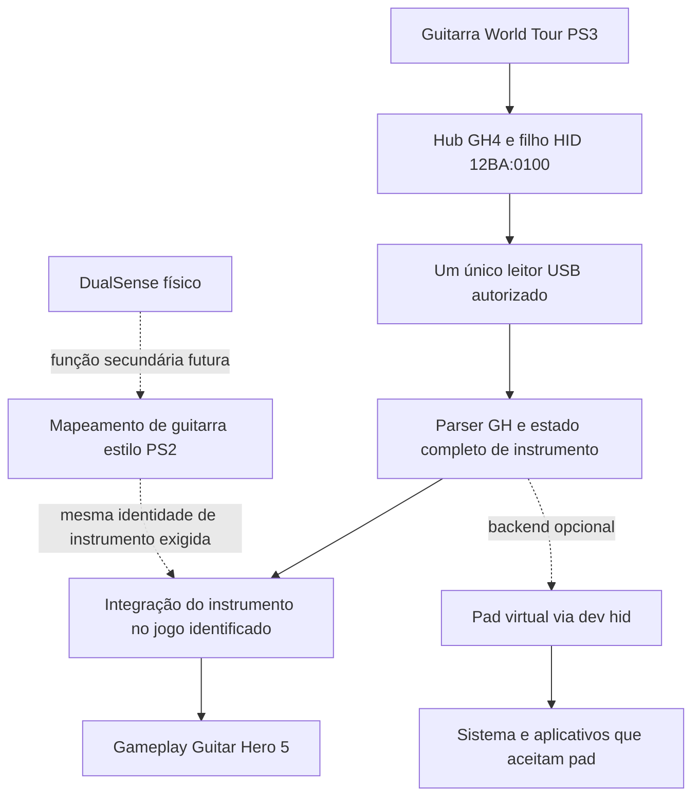

# PS5 Guitar Bridge — relatório de viabilidade

Data: **02/11/2026**. Plataforma pretendida: PS5 desbloqueado, firmware **13.60**, desenvolvimento em Windows. A fase de investigação foi seguida, por autorização explícita do usuário, de um **ELF experimental de diagnóstico USB com interface**, compilado localmente. **Nenhum payload foi executado no console.** As seções 23–24 registram a análise da imagem fornecida e o diagnóstico implementado.

## 1. Resumo executivo

**Há uma rota plausível para este GH5: a imagem se identifica como recompilação da versão Xbox 360 e o binário contém um adaptador de pads PS5 para guitarra Xbox 360, acompanhado de configuração em modo guitarra.** Isso muda a recomendação para **B — payload residente com integração ao sistema de entrada**, usando um pad virtual e o adaptador já presente no port, caso os testes confirmem esse caminho. Continua sem demonstração de guitarra virtual universal em todos os jogos PS4/PS5. Ver seções 20 e 23.

O usuário observou DualSense apenas nos menus, mas ainda não havia testado **segurar o fret e palhetar pelo direcional** como documentado dentro da imagem. Isso é uma observação de uso, não prova de rejeição do DualSense pelo runtime. A prioridade continua sendo guitarra PS3 física com todos os comandos e baixa latência. O esquema PS2 sem palhetada separada seria outra funcionalidade, ainda não implementada.

Resultados principais:

1. **COMPROVADO em dump público e posteriormente na unidade conectada ao Windows:** `1430:4734` é o hub GH4; o dispositivo de entrada atrás dele é `12BA:0100`. São **dispositivos USB distintos na árvore**, não dois IDs intercambiáveis da mesma interface. O dump inicial é World Tour; a unidade local anuncia **Guitar Hero5, revisão `0005`**. Isso corrige a identificação inicial presumida do modelo. Ver seção 22. [Dump World Tour][PB-usb]
2. **COMPROVADO em código e teste de host:** o PS5SX2 contém o parser independente de plataforma `OrbisUsbPadDecode.h`. Os testes originais passaram **82/82** no Windows. O descritor HID de 137 bytes desses testes é idêntico, byte a byte, ao dump público World Tour PS3. Isso não é um teste de funcionamento no console. [Parser][P-decode] · [Testes][P-test] · [Descritor real][PB-hid]
3. **COMPROVADO em código público:** AnyController e FGG-XSense usam ioctls de `/dev/hid` para criar e alimentar um controle virtual. AnyController declara teste em **13.60**. A estrutura entregue ao ioctl **não é `ScePadData`**. Nenhum desses parsers implementa guitarra World Tour pronta. [AnyController][AC-vpad] · [ABI][AC-abi] · [FGG][FGG-vpad]
4. **COMPROVADO em código; uso em jogos relatado pelos autores:** há mecanismos de residência em processos separados e de entrada no sistema. `elfldr` cria processos para payloads; padbridge relata entrada/vibração em um jogo PS4 no PS5 13.60. Isso não comprova reconhecimento global de uma guitarra como instrumento em todos os jogos PS4/PS5. [Loader][EL-spawn] · [padbridge][PAD-readme]
5. **PROVÁVEL para este port, ainda não testado:** um pad virtual pode alimentar o `GuitarAdapter` já contido no binário. `gh5.toml` contém `gh5_pad_mode = "guitar"`; o executável contém mensagens sobre subtipo de guitarra e backend `ps5-scepad`. A hipótese anterior de bloqueio obrigatório por DualSense foi revista com essa evidência. **NÃO CONFIRMADO:** guitarra virtual global reconhecida universalmente por outros jogos.
6. **Alternativa concreta:** PS5Instrumentalizer intercepta `libSceUsbd` dentro de Rock Band 4 e apresenta um instrumento compatível ao jogo. É um precedente real de **compatibilidade por aplicativo**, testado segundo o autor em 13.60, com outro jogo e outro hardware. Não é um driver global nem suporte pronto à guitarra do usuário. [Projeto][RB-readme] · [Hooks][RB-hooks]
7. **Limitação funcional encontrada:** o PS5SX2 trata R1 como tilt no caminho PS3; a documentação World Tour identifica R1 como pedal e o tilt no acelerômetro. Seu parser também não preserva integralmente PS e slider em `GuitarOut`. Reutilizá-lo sem extensão não entrega “100%”. [Conversão][P-decode] · [Protocolo World Tour][PB-gh]
8. **Complemento de 02/11/2026 — identificação no GH5 original:** um log público do GH5 PS3 `BLUS30292` lista imports de `cellPadPeriphGetInfo`, `cellPadGetInfo2` e `cellPadGetData`. O RPCS3 implementa classe/perfil de instrumento na primeira API. Portanto, a investigação da identidade de guitarra deve incluir a camada **pad/periférico**, não somente USB direto. Isso não demonstra que o pacote PS5 use código PS3 ou que já saibamos sua condição de aceitação. Ver seção 21.
9. **Complemento — captura física no Windows:** foram lidos relatórios de **27 bytes** da unidade do usuário. As capturas confirmaram os cinco frets, strum Up/Down, Start, Select, PS, whammy, slider e simultaneidade dos cinco frets. Os campos documentados de aceleração permaneceram constantes; o usuário suspeita de defeito nesse sensor. Isso não comprova funcionamento no PS5 nem mede latência ponta a ponta. Ver seção 22.

**Decisão atual: B — payload residente com integração ao sistema de entrada, como próximo experimento após o diagnóstico USB e a confirmação do modo guitarra do port.** C permanece alternativa se o consumidor real não aceitar o pad virtual. O diagnóstico v0.1 não cria pad e não habilita gameplay. Não há medição que sustente “sem delay” ou garantia de compatibilidade total.

## 2. Método, escopo e inventário reproduzível

### 2.1 Significado das classificações

| Rótulo | Uso neste relatório |
|---|---|
| **COMPROVADO** | Confirmado no código identificado, em dump verificável ou em teste efetivamente executado nesta auditoria. O texto informa qual desses casos é. |
| **PROVÁVEL** | Há código e/ou relatos técnicos coerentes, mas falta reproduzir o comportamento no ambiente do usuário. |
| **NÃO CONFIRMADO** | Informação insuficiente, identidade desconhecida ou teste não realizado. |
| **BLOQUEADO** | Uma dependência identificada impede avançar com aquela abordagem nas condições descritas. Não significa impossibilidade de todas as alternativas. |
| **INVIÁVEL** | Impossibilidade sustentada por evidência nas condições avaliadas; não empregado para preencher lacunas de conhecimento. |

Uma chamada a uma API no fonte comprova sua **implementação no projeto**, não sua execução bem-sucedida em qualquer firmware. Declarações de README e comentários de testes em console são atribuídas aos autores e não foram reproduzidas aqui. Não foram examinados binários do sistema do usuário, kernel ou bibliotecas Sony do console.

A ordem foi: mecanismos globais; Ghostcontrol/AnyController; PS5SX2; USB/protocolo; cruzamento de arquiteturas. Foram usados `git clone --depth 1`, `git log`, `rg`, leitura dos chamadores, headers, Makefiles e licenças. No PS5SX2 a clonagem usou também `--filter=blob:none`, com checkout dos arquivos necessários. Os clones permaneceram fora do projeto em `C:\Users\cabre\AppData\Local\Temp\ps5-guitar-research-20261102`. Todos estavam sem alterações ao final da coleta. Submódulos e árvores históricas completas não foram auditados.

Buscas incluíram USB/HID, Guitar Hero, Rock Band, instrument controller, enumeração, relatórios, libusb, libSceUsbd, uhid/ugen, input mapping, controller emulation, virtual controller, hooks e residência. Resultados de fóruns e agregadores serviram apenas à descoberta; as conclusões técnicas abaixo se apoiam nos fontes ou documentos primários citados.

### 2.2 Repositórios clonados e commits analisados

| Projeto / origem | Commit completo | Data do commit | Escopo efetivamente examinado |
|---|---|---|---|
| [srbraboo/Ghostcontrol-PS5-USB-Controller-Patcher](https://github.com/srbraboo/Ghostcontrol-PS5-USB-Controller-Patcher) | `4a670978e488a9c23f94be18a65deb2fd2761f31` | 08/06/2026 | Payload, transporte USB, parsers Nintendo/Xbox, bind ShellUI, build e avisos de licença. |
| [BallerIsLeet/AnyController](https://github.com/BallerIsLeet/AnyController) | `2eec5ec209f7e20369144de37e2358d1b2af0241` | 24/10/2026 | Todo o caminho main → transporte → parser → vpad; headers, build/CI, licença. |
| [Swordpdf/PS5SX2](https://github.com/Swordpdf/PS5SX2) | `b2a886b48739395de675377b03ecce75ab3368a8` | 30/10/2026 | Parser, leitor PS5, integração main-boot/PadGuitar, testes de host, Makefile e licenças pertinentes. |
| [FGGstore/FGG-XSense](https://github.com/FGGstore/FGG-XSense) | `bfc5f9d324e2ca8b0a90fc498957699caa9fe5b0` | 19/09/2026 | ABI vpad, ciclo principal e documentação da descoberta. |
| [sub0x00001/padbridge](https://github.com/sub0x00001/padbridge) | `3d97019644c8c013c377fbee4ee418f28badc60a` | 23/10/2026 | Criação/bind de pad, seleção USB, residência, energia e relatos de testes. |
| [ps5-payload-dev/sdk](https://github.com/ps5-payload-dev/sdk) | `a7685ce8e97ce1f8a4f38253a41d54241c9124f1` | 20/10/2026 | CRT, suporte de firmware, headers USB, stubs Pad, pré-requisitos e licenças. A tag **v0.45** aponta para esse commit. |
| [ps5-payload-dev/elfldr](https://github.com/ps5-payload-dev/elfldr) | `2a8da002e5292481ea964daa7342bbf4855f4c33` | 21/10/2026 | Spawn de payload, credenciais, bootstrap e documentação de residência. |
| [TheNathannator/PlasticBand](https://github.com/TheNathannator/PlasticBand) | `78fbf4f9bffad89fb928a3e48c893c72977b8de6` | 30/10/2026 | Dumps USB/HID World Tour PS3, protocolo GH PS3, relatório base e licenças. |
| [brunocprado/PS5JB-RB4-XBOXGuitar](https://github.com/brunocprado/PS5JB-RB4-XBOXGuitar) | `e48f2198cf407f95ba035f43e0a3c5c101906c2f` | 06/10/2026 | PS5Instrumentalizer: seleção de jogo, imports USB, hooks, tradutor e licença. |
| [griches/PS5_Dusklight](https://github.com/griches/PS5_Dusklight) | `72d6885cc8b4ff4c5f6be23682ab11578ec926c4` | 21/10/2026 | Apenas identificação do título `PPSA99305`, README, manifesto e licenciamento; não é fonte identificado de GH5. |
| [RPCS3/rpcs3](https://github.com/RPCS3/rpcs3) — complemento seção 21 | `ad468a13f6374f364467a9e4988e95938c37bb42` | 01/11/2026 | `cellPad`/structs, tipos e perfis de guitarra, cadastro de produtos e licença padrão; referência à camada de entrada PS3, sem portar o emulador. |
| [todbot/hidapitester](https://github.com/todbot/hidapitester) — diagnóstico de host, seção 22 | `0f4bb21b83b1aaab84acc4d5f5967922fb7037fe` / tag v0.7 | 24/09/2026 | CLI de diagnóstico existente, fonte de enumeração/leitura examinado; binário Windows oficial com SHA-256 conferido, sem modificar fontes ou criar um leitor próprio. |

Os três links principais existem e foram clonados. Não foi necessário substituí-los por forks presumidos. Ghostcontrol se apresenta como trabalho de StonedModder no README; a auditoria é do snapshot de **srbraboo** solicitado, sem presumir equivalência com releases ou outros forks do autor.

### 2.3 Verificações realmente executadas

- Compilação e execução **somente do teste de host já existente** `ps5/coreorbis/tests/usbpad/test_usbpad.cpp`, sem editar o teste ou o parser. Compilador: `g++.exe (i686-posix-dwarf, Built by strawberryperl.com project) 8.3.0`, `-std=c++17 -Wall -Wextra`. Resultado: **`PASS: 82 of 82 checks passed (USB pads)`**, exit code 0. O executável ficou no diretório temporário de pesquisa.
- Comparação dos bytes de `kPs3Desc` desse teste, removendo comentários, com os bytes brutos das linhas 2–6 do dump HID World Tour. **137 bytes em cada lado; igualdade exata**. [Teste][P-test] · [Dump][PB-hid]
- Na coleta inicial, a consulta somente de leitura ao Windows com `Get-PnpDevice -PresentOnly` não encontrou os pares solicitados. **Posteriormente o usuário conectou/sincronizou a guitarra e foi realizada a captura física descrita na seção 22.** A ausência inicial era apenas o estado daquele momento.
- Verificação de commits, ausência de mudanças nos clones e existência da tag SDK v0.45. Não foram executados ELF, exploração, patches, montagem de jogos ou procedimentos no PS5.

## 3. Auditoria do Ghostcontrol

### 3.1 Caminho realmente utilizado

`main` inicializa usuários/credenciais e `scePad`, inicia captura de klog e o gerenciador; o gerenciador faz probe USB, cria o dispositivo virtual e inicia a thread USB; essa thread interpreta pacotes Nintendo/Xbox e chama `inject_pad`. A saída é um **DualSense virtual**, não uma guitarra virtual. [Entrada principal][G-main]

| Arquivo e linhas | Função / responsabilidade | Dependências e APIs | PS5 / reutilização |
|---|---|---|---|
| `payload/gc_main.c:238–284` | `probe_one_path`: infere o tipo pelo endpoint e tamanho de pacote. | `open`, `USB_FS_INIT`, `USB_FS_OPEN`, detach de interfaces 0/1/2. | Código PS5/FreeBSD; **não lê o VID/PID real nessa função**. Atribui IDs Nintendo/Xbox após o probe. Não reutilizar essa identificação para a guitarra. |
| `payload/gc_main.c:288–330` | `create_vda_for_slot`: cria virtual pad e tenta obter device ID/bind. | `scePadVirtualDeviceAddDevice`, fila de klog, `shellui_pad_force_bind`. | Base global de pad; depende de ambiente privilegiado e log reconhecível. |
| `payload/gc_main.c:165–205` | `parse_klog_line`, `klog_capture_thread`: extrai `DEVICE_ADDED`/device ID. | `/dev/klog`, fallback TCP local 3232. | Frágil a formato do log e concorrência; não é enumeração USB. |
| `payload/gc_main.c:337–552` | `usb_hid_thread`: setup, leitura, parsing, injeção e limpeza. | USB FS, pthreads, parsers específicos. | Reutilizável por partes; endpoints e protocolo atuais não são os da guitarra. |
| `payload/gc_main.c:209–218` | `inject_pad`: entrega um `ScePadData` ao wrapper Sony. | `scePadVirtualDeviceInsertData`. | Encaminhamento real de entrada virtual; sem emulação de instrumento. |
| `payload/gc_main.c:556–700` | `controller_manager_thread`: slots/hotplug e atribuição serializada. | Lista de paths, mutexes, pthreads, sleeps. | Limita o scan efetivo a `/dev/ugen2.*` na linha 566; inadequado assumir mesma porta/barramento com hub. |
| `payload/controller_nintendo.c:34–112` | `nintendo_parse_0x30`, `nintendo_parse_0x3f`, `nintendo_handle_packet`. | Handshake/protocolo Switch, `ScePadData`, helpers USB. | Não é parser HID universal nem parser GH. |
| `payload/controller_xbox.c:44–161` | `xbox_parse_input`, `xbox_gip_handshake`, `xbox_handle_packet`. | Protocolo Xbox One/GIP e USB FS. | Não equivale ao Xbox 360 nem ao PS3 GH. |
| `payload/shellui_pad.c:3242–3338` | `shellui_pad_force_bind`: associa virtual device ao usuário por chamada no ShellUI. | `ptrace(PT_ATTACH)`, resolução de símbolo `sceMbusBindDeviceWithUserId`, `pt_call`, leitura/escrita de memória e proteção de memória via SDK. | Código PS5 intrusivo; o fallback direto está desabilitado sob `__PROSPERO__`. Não presumir compatibilidade 13.60. [Bind][G-bind] |
| `payload/gc_main.c:703–708,746–753` | `elevate_credentials` e inicialização privilegiada. | `kernel_set_ucred_authid`, `kernel_set_ucred_caps`, `scePadSetProcessPrivilege`. | Exige primitivas do jailbreak; não são poderes obtidos por um ELF comum. |

**Advertências concretas do fonte:** o probe destaca várias interfaces antes de autenticar o dispositivo; um endpoint `0x81` de 64 bytes é classificado como Nintendo, característica que também consta do dump World Tour. O startup tenta excluir handles 0–63, sem uma lista de propriedade. Não copiar esses comportamentos para uma ponte que deve coexistir com outros controles. A biblioteca `shellui_pad.c` contém ainda rotinas de patch/hook em ShellCore; sua existência não significa que todas estejam no caminho ativo de `gc_main`. [Fonte][G-main] · [Helper][G-helper]

**Firmware:** o README exige kernel exploit, mas não identifica teste específico de 13.60 no snapshot examinado. Não foi encontrada uma matriz de firmware que justifique declarar suporte desse fork. A saída anunciada de 60 Hz é descrição do projeto, não medição desta auditoria; o laço USB/transferências deve ser medido. Build: `payload/Makefile`, fontes `gc_main.c shellui_pad.c usb_helpers.c controller_nintendo.c controller_xbox.c`; SDK e libs `ScePad`, `SceUserService`, pthread, dl. [Build][G-build]

**Conclusão:** oferece parcialmente a camada necessária para um **pad global**, com custo de privilégios, bind e manutenção. Não oferece pronta a identificação de guitarra e não resolve a restrição de instrumento do GH5. AnyController é um ponto de partida mais simples para experimentar apenas o backend de pad; Ghostcontrol não é a primeira escolha para copiar integralmente.

## 4. Auditoria do AnyController

### 4.1 Arquitetura e chamadas

`main → usb_open_next_controller → ControllerDriver::parse_input → NormalizedInput → vpad_submit_input → ioctl(/dev/hid)`.

| Arquivo e linhas | Função / responsabilidade | Dependências / APIs | Alcance e reutilização |
|---|---|---|---|
| `src/transport/usb.c:51–131` | `try_open`: descritor, match por VID/PID e abertura dos endpoints. | `USB_GET_DEVICE_DESC`, `UGETW`, `USB_IFACE_DRIVER_DETACH`, `USB_CLAIM_INTERFACE`, nós `/dev/usb/B.A.E`. | Implementação PS5; separável do parser. Assume interface **0** e escolhe primeiro endpoint legível/gravável, sem validar toda a configuração. [USB][AC-usb] |
| `src/transport/usb.c:133–171` | `usb_open_next_controller`, `usb_read_report`: scan de `ugen` e read não bloqueante. | `opendir/readdir`, `read`, `EAGAIN/EWOULDBLOCK`. | Identifica dispositivos antes de abrir endpoints; melhor base que probe por tamanho, mas precisa seleção de interface/endpoints descritos. |
| `src/controller.c:18–48` | Registry, `controller_driver_find`, `controller_drivers_init`. | `ControllerDriver`, comparação exata dos dois IDs. | Apenas Switch Pro e Xbox 360 registrados. Enums DS3/generic no header **não são drivers implementados**. [Registry][AC-reg] |
| `include/controller.h:16–98` | `NormalizedInput`, vtable `ControllerDriver`. | C11, bool/inteiros; callbacks init/setup/parse/output/cleanup. | Bom contrato para pad. Para instrumento, manter também semântica própria, sem perder frets, strum, tilt e slider. [Contrato][AC-driver] |
| `src/vpad.c:15–61` | `vpad_init`, `vpad_create`: open HID, descritor virtual, obtenção do handle. | `open("/dev/hid", O_RDWR)`, ioctl ADD. | Independente de PS5SX2; controle de sistema. [vpad][AC-vpad] |
| `src/vpad.c:64–111` | `vpad_submit_input`: traduz bits/eixos e insere estado. | `VpadReport`, ioctl INSERT. | Não chama biblioteca Sony nem faz hook de jogo neste caminho. |
| `src/vpad.c:114–137` | `vpad_destroy`, `vpad_shutdown`. | ioctl DELETE; ownership em slots. | Remover somente handles criados pela própria instância. |
| `src/main.c:128–261` | `release_usb`, `drop_slot`, `begin_grace`, `attach_new_controllers`. | Reabertura USB, pad preservado por 3 s, backoff de 2 s. | Hotplug implementado; parâmetros são política do programa, não latência medida. [Loop][AC-main] |
| `src/main.c:275–345` | `poll_slot`: drena relatórios e publica o último parseado. | Leitura não bloqueante e submissão vpad. | **Risco para strum:** se pressionar e soltar durante a drenagem, só o último estado é entregue. Não copiar assim para jogo rítmico. |
| `src/main.c:347–399` | `main`: inicializa e mantém loop até sinal. | `clock_gettime`, `usleep`, sinais, PID file, log SDK. | Residência do próprio programa, condicionada ao loader manter seu processo. |

### 4.2 Limites importantes

- `include/anycontroller.h:16` configura **8.333 µs (~120 Hz)** para o laço. Isso é valor de agendamento, não frequência medida da guitarra, USB ou jogo. O scan é feito a cada três iterações. [Configuração][AC-config]
- `include/vpad.h:54–77` documenta um relatório de kernel de **0xA0 bytes**, distinto de `ScePadData`; a compilação verifica o tamanho por `_Static_assert`. As constantes de ioctl e posições vêm desse código; não foram deduzidas de endereços de firmware. [ABI][AC-abi]
- `vpad_create(VPAD_DEFAULT_USER)` usa valor 1 no descritor; o programa não descobre o usuário foreground nem faz MBus bind explícito. O README relata seleção de usuário no sistema. O significado completo desse campo e o fluxo correto com o perfil do usuário devem ser validados; não tratá-lo automaticamente como o ID real de um usuário PSN.
- O README declara teste em **13.60** e uso na interface/jogos, mas não traz uma matriz reproduzida aqui de todos os jogos PS5. A afirmação de ausência de verificação do chamador em `/dev/hid` é conclusão dos autores; sem o kernel auditado, o que esta investigação confirma diretamente são os ioctls e o fluxo do código. [README][AC-readme]
- `NormalizedInput` tem campos de movimento, mas a submissão não implementa todo esse estado; o README aponta movimento, rumble e Create como incompletos/não verificados. Não usar isso para prometer tilt nativo completo. [Contrato][AC-driver] · [Saída][AC-vpad]
- Não há `12BA:0100` registrado. Adicionar apenas um ID não implementa protocolo, semântica de instrumento ou recuperação robusta.

**Reutilização mínima do backend de pad:** `src/vpad.c`, `include/vpad.h`, `include/sce_pad.h`, `include/controller.h` e `include/anycontroller.h`, com adaptação do estado de entrada. Para manter transporte/gerência, acrescentar `src/transport/usb.c`, `include/transport/usb.h`, `src/controller.c` e partes pertinentes de `src/main.c`. Os drivers Switch/Xbox não são necessários para uma versão apenas GH. O Makefile atual usa SDK v0.45+, C11 e `-lkernel_sys`. [Build][AC-build]

## 5. Auditoria do PS5SX2 e portabilidade do parser

### 5.1 Separação entre herança PCSX2 e código PS5

| Camada | Arquivo / funções | O que faz | O que não comprova |
|---|---|---|---|
| **Específica do port PS5**, copyright 2026 swordpdf | `ps5/coreorbis/orbis-shims/OrbisUsbPadDecode.h`, funções abaixo | Decodifica descritores/relatórios e representa entradas. | Não cria controle no sistema PS5. [Parser][P-decode] |
| **Específica do port PS5** | `.../ProsperoUsbPad.cpp`, `TryUhid`, `TryUgen`, `TryUsbd`, `ReadReport`, `Thread` | Abre hardware PS5 e alimenta o parser. | Não torna sua thread independente do processo do emulador. [Leitor][P-usb] |
| **Integração específica PS5SX2** | `ps5/coreorbis/main-boot.cpp:800–837`, `orbis_pad_apply_guitar`; linhas 4711–4731 e 4780–4799 | Funde entradas e configura PS2 port 1 como Guitar. | Não registra guitarra globalmente no PS5. [Integração][P-main] |
| **Herdada do PCSX2**, copyright PCSX2 Dev Team | `pcsx2/SIO/Pad/PadGuitar.cpp`, `PadGuitar::Set`, `Poll`, `SendCommandByte`; `.h` | Emula o protocolo de controle Guitar do PS2. | Não é leitor USB do dongle PS3 nem driver PS5. [PadGuitar][P-guitar] |
| **USB emulado herdado** | `pcsx2/USB/usb-pad/usb-pad.cpp`, `pad_handle_data`, `PadDevice::CreateDevice`, `RBDrumKitDevice::CreateDevice` | Dispositivos apresentados ao **PS2 convidado**, incluindo bateria Rock Band. | Não é enumeração física do USB PS5. [USB convidado][P-guestusb] |

Referências `sceUsbd*` em `pcsx2/IopModuleNames.cpp` são nomes de exports do **PS2 emulado**. Não constituem prova da ABI Sony PS5. O prefixo `Orbis` nos shims também não transforma sozinho uma API PS4 em suporte testado a PS5: o caminho usado e o ambiente de execução precisam ser examinados.

### 5.2 Funções do parser, todas no mesmo header

Prefixo completo: `ps5/coreorbis/orbis-shims/OrbisUsbPadDecode.h`. [Fonte integral][P-decode]

| Linhas | Função / tipos | Responsabilidade | Dependências e portabilidade |
|---|---|---|---|
| 33–201 | `HidField`, `HidLayout`, `ParseHid` | Interpreta itens HID, usos, offsets em bits, ranges e Report IDs. | Somente STL/tipos padrão; não usa APIs PS5. |
| 203–214,265–279 | `ExtractBits`, `Scale8`, `FieldValue` | Extrai campos e normaliza sinais/eixos. | Independente de console; exige limites de relatório coerentes. |
| 282–352 | `DecodeHid` | Converte campos de gamepad em `Common`. | Usa layout obtido do descritor. Ignora usos vendor-defined de movimento neste caminho. |
| 354–371 | `DecodePs3Fixed` | Botões nos bytes 0–1, hat no 2, eixos nos 3–6. | Não exige PCSX2. Aceita mínimo de 7 bytes; isso não valida o relatório completo de 27 bytes do modelo. |
| 375–404 | `DecodeDs3` | DualShock 3 report 1. | **Não substituir** o parser Guitar Hero por este: ambos serem PS3 não torna o formato igual. |
| 415–450 | `DecodeXInput` | Xbox 360. | Não se aplica ao dongle PS3 original. |
| 456–481 | `SystemOwned`, `LooksLikeGuitar` | Proteção de dispositivos Sony e heurística por IDs/nome. | Match conhecido `12BA:0100`; não contém tratamento GH4 hub como guitarra. Heurística por nome não é validação suficiente. |
| 515–539 | `ToPad` | Converte estado comum a bits/eixos usados pelo port. | Usa Select sintético `0x40000000`, privado do emulador. Não enviar esse bit diretamente ao sistema. |
| 541–580 | `GuitarOut`, `WhammyCal`, `ToGuitar` | Frets, strum, Start/Select, whammy, tilt simplificado. | Reutilizável com as ressalvas de tilt/slider/PS e calibração. |
| 586–601 | `GuitarAsPad` | Mapeamento compatível com os bindings Guitar PS2 do PCSX2. | Não altera classe/identidade do dispositivo entregue ao sistema ou ao jogo. |
| 605–662 | `Target`, `FindTarget` | Percorre interfaces e endpoints interrupt IN; pula boot keyboard/mouse. | Portável; escolhe primeiro alvo e alt setting 0. Não é seletor universal de todos os dispositivos compostos. |

**Resposta principal: sim, o parser pode ser utilizado em um ELF independente.** Para os parsers e tipos já existentes, basta esse **header**, com C++17 ou superior e os headers/runtime padrão que efetivamente forem usados: `algorithm`, `cctype`, `cmath`, `cstddef`, `cstdint`, `cstring`, `string`, `vector`. `std::clamp` exige ao menos C++17; o projeto completo compila em C++20. Não exige emulador, BIOS, renderização, Vulkan, SDL ou `PadGuitar`. O teste de host demonstra essa separação, não a compatibilidade do binário resultante com o loader PS5. [Teste][P-test] · [Build PS5SX2][P-build]

É possível extrair só o caminho GH e evitar partes genéricas/STL, mas essa extração seria **trabalho futuro**, com preservação de licença e testes. A integração com o AnyController em C exige um adaptador C/C++ ou a conversão documentada de uma parte pequena; não basta incluir um header C++ em um `.c`.

### 5.3 Leitor USB do PS5SX2

Arquivo completo: `ps5/coreorbis/orbis-shims/ProsperoUsbPad.cpp`. [Fonte][P-usb]

| Linhas / função | Responsabilidade e APIs | Evidência / reutilização |
|---|---|---|
| 214–247 `Classify` | Seleciona formato por descritor, IDs ou heurística; chama `ParseHid`. | Reutilizável por partes; fallback amplo por VID/nome precisa restringir ao dispositivo real. |
| 271–309 `TryUhid` | Abre `/dev/uhidN`, tenta `USB_GET_DEVICEINFO` e `USB_GET_REPORT_DESC`. | Rota implementada, **existência funcional no PS5 13.60 não demonstrada**. |
| 313–332 `UgenRequest` | Control transfer com `USB_DO_REQUEST`. | Depende do ioctl real no nó aberto, não apenas do header FreeBSD. |
| 345–370 `UgenFsOpen` | Prepara endpoint via USB FS. | Depende de `<dev/usb/usb_ioctl.h>` e acesso ao dispositivo. |
| 382–593 `ProbeUgen`, `PollCandidates` | Diagnóstico e identificação por formato de relatórios quando faltam descritores. | **Não recomendar probe cego:** pode consumir entrada de outro controle ou interferir em armazenamento. |
| 595–692 `TryUgen` | Enumera descritores, escolhe interface/endpoint, lê descritor HID, detach/claim seletivo e abre nó ou USB FS. | Mais completo que escolher primeiro endpoint. Em `USB_GET_DEVICEINFO` falho entra na rota de probe. |
| 707–773 `UsbdLoad` | Carrega `libSceUsbd.sprx`, resolve funções `sceUsbd*`, inicializa. | As assinaturas são assumidas como semelhantes a libusb; marcador impede repetição após inicialização que não retorna. Não tratar como ABI 13.60 comprovada. |
| 801–886 `TryUsbd` | Device list, descritores/control transfers, classifica e abre interrupt IN. | Rota alternativa; precisa validar módulos, assinatura, claim e retorno no console. |
| 891–967 `ListNodes`, `Scan` | Ordena rotas/varredura e candidatos. | Política específica do emulador/flag files. |
| 969–1034 `ReadReport` | `poll/read`, USB FS ou `sceUsbdInterruptTransfer`. | Trata timeouts e desconexão; timeout configurado **250 ms** é limite de espera, não atraso fixo de cada relatório. |
| 1036–1143 `Decode`, `Thread` | Loop, reconexão e atualização de `s_out`. | Thread publica o último estado sob mutex; a vida útil é a do processo PS5SX2. |
| 1146–1190 `OrbisUsbPadStart`, `OrbisUsbPadWaitGuitar`, `OrbisUsbPadState` | Inicialização/consulta para o frontend. | Não são API de controle global. |

Para reaproveitar o **leitor inteiro sem adaptar**, seriam necessários também `ProsperoUsbPad.h`, `ProsperoNotify.h` e implementação correspondente, `ps5/coreorbis/include-orbis/OrbisPaths.h` e implementações de `OrbisFlag`/`OrbisLogPath`, sincronização C++/pthread, APIs de arquivos/ioctl e resolução dinâmica dos módulos. Isso carrega dependências e políticas do aplicativo desnecessárias. Recomenda-se reaproveitar o parser e a seleção de descritores, e desenvolver posteriormente um transporte restrito ao dongle identificado, em vez de copiar o leitor todo.

### 5.4 Limites que os testes não cobrem

O teste contém relatórios construídos pelo próprio código, não uma sessão capturada de gameplay. A igualdade do descritor fortalece os offsets de botões/eixos, mas não valida sensor, RF, periodicidade ou enumeração PS5. `DecodeHid` só utiliza páginas 1 e 9 para o estado comum; movimento vendor-defined não chega a `ToGuitar`. `ToGuitar` usa R1 como tilt PS3, enquanto o modelo World Tour documenta R1 como pedal. O `GuitarOut` não tem campos PS nem slider. Whammy é calibrado a partir do primeiro relatório: ligar segurando a barra desloca o repouso. [Parser][P-decode] · [Modelo real][PB-gh]

## 6. Identificação do hardware USB

**COMPROVADO para o receptor do dump World Tour PS3:**

```text
Porta USB do host
└── 1430:4734 — GH4 Hub — classe USB 09 — três portas
    └── 12BA:0100 — Guitar Hero4 for PlayStation (R) 3
        └── interface 0, classe HID 03, alt 0
            ├── interrupt IN  0x81
            └── interrupt OUT 0x02
```

O arquivo `Docs/Descriptor Dumps/USB/Guitar Hero World Tour PS3 Guitar USB Descriptors.txt:3–16` contém a enumeração Linux pai/filho; linhas 20–63 descrevem o hub; 68–127 descrevem o filho HID. Portanto, a hipótese do hub tem evidência melhor que uma associação por família ou um banco de nomes USB. **Não se deve destacar o driver do hub nem ler seu endpoint como se fossem comandos da guitarra.** [Dump][PB-usb]

| Propriedade do filho HID | Valor no dump | Limite da afirmação |
|---|---|---|
| VID/PID | `12BA:0100` | Confirmar unidade/revisão do usuário. |
| Product string | Guitar Hero4 for PlayStation (R) 3 | Não usar apenas essa string como autorização para detach. |
| Configuração / interface / alt | 1 / 0 / 0 | Um filho HID próprio; não é “interface extra com outro VID” do hub. |
| IN / OUT | `0x81` / `0x02`, interrupt, máximo 64 bytes | **64 é tamanho máximo de pacote**, não tamanho do estado de entrada. |
| Report descriptor | 137 bytes | Corresponde ao fixture do teste PS5SX2. |
| Report de entrada | 27 bytes, sem Report ID no descritor | Confirmar o que a API do host devolve antes de interpretar. |
| `bInterval` IN/OUT | `0x0A` | No full-speed do dump corresponde a intervalo nominal de 10 ms; não é medição de relatórios efetivos nem da latência total. |

Fonte e atribuição das tabelas de protocolo/topologia: PlasticBand, TheNathannator e contribuidores, documentos/dumps citados, CC BY-SA 4.0. A apresentação foi resumida e reorganizada; essas adaptações documentais seguem a mesma licença. [Licença documental][PB-license]

## 7. APIs e permissões no PS5 13.60

| Recurso | Evidência real | Classificação para esta proposta |
|---|---|---|
| Enumeração `ugen` e nós `/dev/usb/B.A.E` | AnyController `usb_open_next_controller`/`try_open`; alvo declarado 13.60. | **PROVÁVEL** no ambiente do usuário; implementado e relatado em 13.60. Não depende de supor que todo FreeBSD tenha os mesmos nós. |
| VID/PID com `USB_GET_DEVICE_DESC` | AnyController abre nó de controle `.0` e lê `idVendor/idProduct`. | Caminho preferido para validar; medir retorno/errno em cada nó. |
| `USB_GET_DEVICEINFO` | PS5SX2 relata **ENOTTY em 13.60** para nós ugen; AnyController usa outro ioctl e outro path. | **NÃO CONFIRMADO** uniformemente. Diferença de ioctl/path importa; as duas observações não são equivalentes. [Aviso 13.60][P-usb] |
| Configuração/interfaces/endpoints | `USB_GET_FULL_DESC` em PS5SX2/padbridge; `FindTarget` percorre descritores. | Implementado; confirmar ioctl e descriptor bytes na unidade. Não presumir interface 0 para qualquer hardware. [Seleção][PAD-usb] |
| Transferências em endpoint | `read` não bloqueante e USB FS nos projetos. | Evidência mais forte que depender inicialmente de uma nova porta libusb. |
| `libSceUsbd` | PS5SX2 carrega dinamicamente; PS5Instrumentalizer resolve imports reais no processo de um jogo PS4. | Existência de uso público comprovada; **ABI/uso do leitor PS5SX2 em ELF independente 13.60 não confirmado**. |
| `libusb` | Estruturas/conceitos em projetos; RB4 usa ABI semelhante a libusb para hooks. | Não foi identificada neste SDK uma dependência libusb host pronta necessária à solução. “Parece libusb” não prova biblioteca instalável no console. |
| `/dev/uhidN` | Caminho tentado pelo PS5SX2; AnyController relata ausência de uhid em seu ambiente. | **NÃO CONFIRMADO**; não basear o projeto nessa rota. Um branch de fallback não comprova dispositivo presente. |
| `/dev/hid` + ADD/INSERT/DELETE | AnyController/FGG; padbridge usa wrappers `scePadVirtualDevice*`. | Base concreta de **pad** virtual; não comprova USB guitar virtual global. |
| `scePad*`, `sceUserService*`, `sceMbus*` | Ghostcontrol/padbridge; stubs de Pad no SDK. | APIs internas/engenharia reversa, não contrato público Sony de homebrew. Carregamento e credenciais variam. |
| Primitivas de kernel do SDK | `crt/kernel.c:557–565` tem caso 13.60; loader e Ghostcontrol as usam. | Prova de suporte de offsets no SDK; **não fornece, por si só, acesso ao kernel**. Não copiar offsets para outro firmware. [SDK][SDK-fw] |

A definição de `USB_GET_DEVICE_DESC`, `USB_GET_FULL_DESC`, `USB_DO_REQUEST`, `USB_CLAIM_INTERFACE` e USB FS em `include/freebsd/dev/usb/usb_ioctl.h` apenas permite compilar chamadas. Sua aceitação pelo kernel deve ser verificada. [Headers SDK][SDK-usb]

**Permissões mínimas a verificar:** acesso de leitura aos diretórios de dispositivos e descritores; abertura do controle USB e da interface alvo; capacidade de detach/claim apenas quando necessário; acesso R/W a `/dev/hid` se o backend de pad for usado; arquivos de logs/estado; processo que não pertença ao aplicativo que será fechado ao abrir o jogo. Para hooks remotos, também memória/processo/ptrace permitidos pelo jailbreak. Um jailbreak “funcional” não garante esse conjunto.

`elfldr_raise_privileges` usa primitivas existentes para rootdir/jaildir/uid/caps; não explora uma vulnerabilidade nova para concedê-las. Ghostcontrol altera authid/caps; padbridge faz elevação/restauração. AnyController não executa elevação equivalente explicitamente em `main`, dependendo do contexto recebido. Por isso o loader exato e seus privilégios herdados são parte do diagnóstico. [Loader][EL-creds] · [Ghostcontrol][G-main] · [padbridge][PAD-vpad]

## 8. Leitura e interpretação HID da World Tour PS3

### 8.1 Formato documentado

Offsets abaixo são **zero-based no payload USB de 27 bytes, sem byte artificial de Report ID**. O descritor não contém item Report ID. A representação Windows documentada adiciona um byte 0 no início; esse prefixo da API não deve ser tratado como presente no `read` do PS5 sem captura que o demonstre. [Protocolo][PB-gh] · [Dump][PB-hid]

| Comando / campo | Offset e máscara/valor | Evidência e ressalva |
|---|---|---|
| Yellow | byte 0, `0x01` | Square no protocolo GH PS3. |
| Green | byte 0, `0x02` | Cross. |
| Red | byte 0, `0x04` | Circle. |
| Blue | byte 0, `0x08` | Triangle. |
| Orange | byte 0, `0x10` | L1. |
| Pedal / Star Power por pedal | byte 0, `0x20` | R1/RJ14 segundo a documentação; não chamar automaticamente de tilt. |
| Select / Back | byte 1, `0x01` | Também pode ativar Star Power conforme o jogo. |
| Start | byte 1, `0x02` | Independente dos frets. |
| PS | byte 1, `0x10` | Existe no formato; verificar emissão no hardware/rota usada. |
| Hat / strum | byte 2; Up `0`, Down `4`, neutro documentado `0x1F` | Parser lê nibble baixo e normaliza valores >7 para neutro. Diagonais existem no formato. |
| Eixos não usados de left stick | bytes 3–4 | Não interpretar como sensores sem evidência. |
| Whammy | byte 5 | Repouso `0x7F/0x80`, curso até `0xFF` documentado. Confirmar extremos e repouso físico. |
| Touch/slider bar | byte 6 | Posições/segmentos dependem do modelo/calibração; não inventado aqui um mapeamento completo. |
| Pressure data | bytes 7–18 | Não usar no lugar dos bits: há eixos compartilhados que podem zerar com duas entradas simultâneas. |
| Tilt / accel X | bytes 19–20, little-endian, faixa nominal de 10 bits | Abaixo de `0x200` com guitarra apontada para cima; calibrar, filtrar e aplicar histerese. |
| Accel Y / Z | bytes 21–22 / 23–24, little-endian | Documentação nominal `0x180–0x280`; variação e quirks World Tour descritos na fonte. |
| Angular-rate reservado/não usado | bytes 25–26 | Não converter automaticamente em giroscópio funcional. |

A disposição se sustenta no descritor e na struct documentada de PlasticBand; os primeiros sete bytes e botões também coincidem com `DecodePs3Fixed`/`Ps3Button` do PS5SX2. **A seção 22 acrescenta validação física no Windows dos botões/eixos indicados; o sensor de tilt permanece não validado.** A revisão local anuncia GH5, e o neutro de hat efetivamente observado foi `0x0F`. [Dump USB/HID][PB-usb] · [Parser][P-decode]

### 8.2 O que reaproveitar e o que completar

- Reaproveitar `ParseHid`, `FindTarget`, `DecodePs3Fixed`/`DecodeHid`, enumeração de botões e a parte validada de `ToGuitar`.
- Preservar **todos os estados simultâneos**, frets e strum separados, em estrutura de instrumento; converter só no backend escolhido.
- Completar aceleração/tilt a partir do report real, PS, slider e política do pedal. O parser atual não atende esses requisitos integralmente.
- Não usar o mapeamento Rock Band por similaridade: no PS5Instrumentalizer os símbolos amarelo/azul do relatório RB estão em posições diferentes das documentadas para GH. O alvo `12BA:0200` do hook não é substituto automático de `12BA:0100`. [GH][PB-gh] · [RB][RB-translate]
- Qualquer inicialização ou output report exigido pelo dongle deverá ser observado. Não enviar a sequência de habilitação DS3 ou handshakes Nintendo/Xbox à guitarra por ela ser “um controle USB”.

### 8.3 Captura futura verificável

No Windows, obter árvore USB/descritores do filho com USBView ou ferramenta de dump HID, registrando revisão e descritor bruto. Capturar repouso, cada fret, acordes, cada sentido do strum, strums alternados rápidos, Start/Select/PS, whammy em extremos/intermediários, slider e orientação do corpo; registrar timestamps e botão/ação correspondente. No PS5, depois de aprovação de diagnóstico, comparar bytes e comprimento recebidos com o mesmo roteiro. Em ambos, separar Report ID do prefixo introduzido pela API.

Medir relatórios por segundo e distribuição entre timestamps em repouso e movimento. `bInterval` não demonstra se o dongle envia repetidamente ou apenas quando muda o estado. Não confundir rádio sincronizado/LED ligado com recepção funcional pelo sistema.

## 9. Controle virtual: mecanismos reais e o limite de instrumento

### 9.1 Pad global por ioctl direto

AnyController `include/vpad.h:20–33` define ADD `0xC018482A`, INSERT `0x8018482C`, DELETE `0x80104850`, requisição de 24 bytes para ADD/INSERT e requisição própria para DELETE. `src/vpad.c` abre `/dev/hid`, cria um descritor de 168 bytes e mantém um estado de pad de 0xA0 bytes. Os valores são **transcritos do código público citado**, não novos endereços ou offsets descobertos nesta auditoria. [ABI][AC-abi]

Esses bytes constituem uma ABI reversamente documentada, não um relatório USB DualSense nem o relatório GH. Passar os 27 bytes da guitarra ou uma struct `ScePadData` diretamente a INSERT é incorreto. É necessário converter estado e montar o formato esperado, preservando neutralidade, eixos e simultaneidade. [FGG descoberta][FGG-vpad] · [AnyController submissão][AC-vpad]

### 9.2 Pad global por wrappers e bind

Ghostcontrol e padbridge usam `scePadVirtualDeviceAddDevice`/`InsertData`/`DeleteDevice`. padbridge carrega `libSceMbus` antes de inicializar `scePad`, identifica device ID pelo log e associa usuário com `sceMbusBindDeviceWithUserId`. É um caminho mais complexo, mas oferece precedente de gerenciamento de perfil e integração em 13.60. O código de bind do padbridge é direto no próprio processo, diferentemente do attach em ShellUI usado pelo Ghostcontrol auditado. [padbridge][PAD-vpad] · [Ghostcontrol bind][G-bind]

FGG relata aceitar onze tipos de dispositivos em testes em **11.60**, mas o caminho publicado aqui usa protocolo 3/classe pad. **Isso não prova que um desses tipos seja guitarra, nem documenta descritor/relatório de instrumento global 13.60.** Não escolher um tipo numérico desconhecido e chamá-lo de guitarra. [Header FGG][FGG-header]

### 9.3 Instrumento por aplicativo: precedente relevante

**PS5Instrumentalizer**, no repositório PS5JB-RB4-XBOXGuitar:

- `src/versions.c:13–40` restringe os títulos a `CUSA02084`/`CUSA02901` e tem versão conhecida 02.21. Não contempla `PPSA99305`. [Alvos][RB-versions]
- `src/inject.c`, `resolve_usbd`, `scan_import_slots`, `inject_stub`, `apply_plan`, `inject_rollback`: resolve chamadas USB reais do jogo, prepara a injeção, altera os imports e oferece rollback. Exige acesso privilegiado a processos. [Injeção][RB-inject]
- `stub/usb_hooks.c`, `stub_hook_open`, `stub_hook_get_device`, `stub_hook_get_config`, `stub_hook_fill_interrupt`, `translate_callback`: intercepta descritores/transferências e apresenta guitarra PS3 Rock Band ao jogo. [Hooks][RB-hooks]
- `stub/translate.c`, `translate_xinput_guitar`: traduz instrumento Xbox 360 para o formato esperado. Esse parser não interpreta diretamente o receptor GH PS3 aqui discutido. [Tradução][RB-translate]
- README relata teste em PS5 13.60 com guitarra Xbox 360 **com fio** e RB4 PS4 v02.21; receptor wireless é implementado, mas não testado segundo o autor. [Relato][RB-readme]

É uma solução de **instrumento percebido pelo jogo**, sem criar um USB virtual enumerado globalmente no host. Por isso é um precedente melhor para a restrição informada do que apenas remapear cinco frets para botões de DualSense. Não basta mudar o título alvo ou copiar offsets: precisam coincidir formato do jogo, importação, ABI e protocolo de instrumento.

## 10. Funcionamento global: respostas separadas A–D

| Problema | Resultado | Evidência e limite |
|---|---|---|
| **A. Ler USB continuamente em ELF independente** | **PROVÁVEL para o dongle em 13.60; implementado para outros controles.** | AnyController/FGG/padbridge demonstram arquitetura; falta abrir e ler o filho real World Tour na configuração do usuário. |
| **B. Interpretar a guitarra** | **COMPROVADO para parser/base de protocolo; incompleto para 100% do modelo.** | Testes 82/82, descritor idêntico, offsets publicados; tilt/PS/slider e calibração precisam completar e validar. |
| **C. Criar controle virtual compatível** | **COMPROVADO em código para pad; NÃO CONFIRMADO para instrumento global.** | `/dev/hid` e wrappers existem nos projetos. A identidade USB de guitarra que certos jogos procuram não é criada por esses backends. |
| **D. Continuar enquanto outro jogo executa** | **PROVÁVEL no loader/contexto correto; uso público documentado para pads.** | Processos de payload em elfldr, laços residentes e testes relatados em jogos. Validar suspensão/encerramento e permissões no console específico. |

Classificação das soluções encontradas:

| Solução | Categoria solicitada | O que foi demonstrado |
|---|---|---|
| AnyController/FGG/padbridge como pad | **Solução global comprovada em implementação pública, com funcionamento relatado; não reproduzida nesta auditoria.** | Entrada de pad no sistema; testes em 13.60 declarados no AnyController/padbridge. Não comprova “todos os jogos”. |
| World Tour → parser → pad global | **Solução global plausível, ainda não testada.** | As peças existem, mas transporte/modelo e cadeia completa não foram testados; gameplay do GH5 permanece problema separado. |
| World Tour → instrumento global para jogos que recusam pad | **Nenhuma solução global demonstrada com os mecanismos identificados.** | Não foi encontrado backend público que anuncie essa guitarra globalmente com o protocolo exigido por qualquer jogo. Isso não é prova de inviabilidade absoluta. |
| PS5SX2 | **Solução restrita a emuladores.** | Leitor físico + `PadGuitar` no PS2 convidado; não publica instrumento global. |
| PS5Instrumentalizer | **Solução restrita a determinado aplicativo.** | RB4 PS4, versões/IDs conhecidos, outro hardware de entrada. |
| Mapear para DualSense e considerar GH5 resolvido | **Abordagem insuficiente para o requisito observado.** | O usuário já observou a recusa de gameplay com DualSense. Não confundir injeção bem-sucedida com compatibilidade de instrumento. |

## 11. Processos residentes e convivência com jogos

`elfldr/README.md:4–9` descreve execução em background durante jogos e processos individuais para payloads. Isso é sustentado por `socksrv.c:124–144` chamando `elfldr_spawn` e por `elfldr.c:603–698` criando processo e carregando o ELF. O bootstrap inicial usa recursos privilegiados; o nosso leitor não precisaria repetir esse bootstrap nem injetar seu loop em um jogo para permanecer vivo, se lançado por um loader que já ofereça esse ambiente. [Arquitetura loader][EL-readme] · [Código][EL-spawn]

AnyController mantém `main` executando; **não se daemoniza sozinho**. Não basta enviar um ELF para qualquer loader ou colocar uma thread dentro de um app que será fechado. A identidade/versionamento do loader/etaHEN e a permanência do PID são critérios de validação, não pressupostos.

padbridge contém tratamento explícito de energia: `src/ps5_power.c:17–36` consulta `SceSystemStateMgrInfo`; `src/main.c:250–261,352–365` libera dispositivos, espera retorno e permite reenumeração. Esse precedente não garante que a ponte sobreviva ao rest mode com o mesmo dongle. A primeira versão deve limitar seu contrato a console acordado, até validar suspensão/retomada. [Energia][PAD-power] · [Loop][PAD-main]

Um pad deixado registrado pode sobreviver ao encerramento do processo segundo os headers FGG/AnyController; isso **não mantém a entrada atualizada**. Um leitor morto pode deixar botões presos ou dispositivos órfãos. Exigir neutralização, limpeza de handles próprios, exclusão mútua entre instâncias e recuperação após reinício.

## 12. Alternativas de arquitetura

| Alternativa | Viabilidade / firmware 13.60 | Dependências / privilégios | Durante jogos | Complexidade, riscos e limites |
|---|---|---|---|---|
| **A — ELF independente, pad virtual global** | Plausível, com base AnyController. Não atende sozinho ao GH5 que recusa pad. | SDK, loader residente, USB e `/dev/hid`; privilégios do contexto. | Relatada para pads; validar no console. | Menor complexidade do backend; identidade de instrumento ausente, risco de perder strums no loop original. |
| **B — payload residente integrado ao sistema** | Residência possível via loader; instrumento global ainda não demonstrado. | Backend de pad ou nova integração comprovada, gestão de usuário/energia; hooks exigiriam mais privilégios. | Arquitetura apropriada para serviço contínuo. | Residência resolve vida útil, não protocolo de guitarra. Kernel patch novo não é justificado como primeira solução. |
| **C — plugin/patch do jogo, recomendado** | Precedente em PS5Instrumentalizer/RB4 13.60. Aplicação ao GH5 depende da implementação instalada. | Identificar processo/versão/imports; parser/transporte ou entrega direta à entrada de instrumento; ptrace/memória se hook binário. | Sim para o jogo alvo, se integração funcionar. | Médio/alto; manutenção por versão e risco de crash. Melhor caminho para satisfazer identidade de instrumento; não é universal. |
| **D — integração no código de um port/emulador** | Preferível ao hook binário se houver fonte correspondente ao pacote. PS5SX2 já faz isso internamente. | Fonte/revisão do port; backend de instrumento da plataforma convidada. | Dentro do aplicativo correspondente. | Mais controlável e testável; não afirmar que o pacote GH5 usa esse emulador sem evidência. Pode viabilizar DualSense como guitarra PS2. |
| **E — arquitetura externa/hardware ou novo driver kernel** | Nenhuma opção adicional foi comprovada para este receptor/jogo nesta auditoria. | Hardware/protocolo/autenticação ou pesquisa kernel específicos. | Desconhecido. | Não recomendada agora; substituir uma lacuna por outra não demonstra viabilidade. |

As letras nesta tabela descrevem arquiteturas; na decisão final usa-se a opção **C** da lista final solicitada. Não foi identificada necessidade comprovada de alterar firmware ou de instalar um driver kernel novo para simplesmente ler o dispositivo ou criar um pad virtual. Isso não autoriza supor que todos os acessos já estejam liberados no jailbreak atual.

## 13. Dependências, ambiente de compilação e licenças

**Atualização de implementação:** o inventário de ambiente abaixo registra a inspeção inicial. Posteriormente foram preparados LLVM/LLD **18.1.8** e SDK **v0.45** portáteis em Windows, sem instalar WSL. O ELF C11 foi compilado e inspecionado; a seção 24 e `tools/build.ps1` descrevem o ambiente efetivamente utilizado.

### 13.1 Ambiente inspecionado

| Item | Resultado local |
|---|---|
| Git / GitHub CLI / ripgrep | Disponíveis. |
| C++ para testes de host | `C:\Strawberry\c\bin\g++.exe`, GCC 8.3.0, alvo i686; executou teste C++17. **Não é compilador de payload PS5**. |
| Clang/Clang++, CMake, Ninja, make e Docker nos comandos consultados | Não encontrados no PATH. Isso não prova ausência de toda instalação fora do PATH. |
| WSL | `wsl.exe` existe; a consulta de distribuições não listou nenhuma. Não foi encontrada uma distribuição pronta para build. |
| Python no PATH | Entradas `WindowsApps\python.exe`/`python3.exe`; não tratadas como runtime funcional verificado. |
| `PS5_PAYLOAD_SDK` | Variável não definida. O SDK foi clonado como **referência**, não instalado como toolchain. |

**Proposta inicial, posteriormente substituída pelo build Windows da seção 24:** WSL2 com distribuição Linux suportada, SDK **ps5-payload-dev/sdk v0.45** fixado por commit, Clang/LLD e ferramentas conforme README do SDK. O README lista Clang/LLD 18 e Bash; o build/CI do AnyController usa SDK v0.45, make e LLVM. Para conservar o parser C++ com STL, seria necessário também libc++/runtime conforme `sdk/README.md:52–57`. O diagnóstico C11 dispensou STL, WSL e container. [SDK][SDK-readme] · [CI][AC-ci]

Não compilar o PS5SX2 inteiro para obter o parser. Seu runtime gráfico, JIT, BIOS e dependências do emulador não são necessários ao componente HID independente.

### 13.2 Licenças efetivamente verificadas

| Projeto / parte | Licença encontrada | Consequência para reutilização |
|---|---|---|
| Ghostcontrol | `GPL-3.0-or-later` nos headers principais e README; sem arquivo LICENSE raiz no snapshot. | Preservar autoria/SPDX, fornecer texto de licença e fonte correspondente ao distribuir derivado. Conferir headers de cada arquivo incorporado. |
| AnyController | Arquivo `LICENSE` GPLv3; README declara GPL-3.0. | Não presumir “or later” para todo o projeto. Copiar código implica preservar avisos e cumprir GPLv3 no trabalho derivado distribuído. |
| PS5SX2 / parser e leitor | Headers copyright swordpdf, `GPL-3.0-or-later`; `COPYING.GPLv3`. | Extração permitida nos termos GPL; manter avisos, marcar mudanças e disponibilizar fonte correspondente se distribuir binário derivado. |
| PCSX2 / PadGuitar | `GPL-3.0+`, PCSX2 Dev Team. | Mesmas obrigações pertinentes; não copiar o emulador inteiro por necessidade inexistente. |
| FGG-XSense | `LICENSE` GPLv3 e README GPL-3.0. | Mesma cautela da versão exata do AnyController. |
| padbridge | GPL-3.0-or-later; créditos indicam origem de partes em AnyPad PS5. | Preservar também avisos/autores herdados dos arquivos selecionados. |
| SDK / elfldr | GPLv3+ por padrão; headers FreeBSD do SDK sob licenças BSD próprias. | Runtime e fontes incorporados precisam inventário; não rotular todo o SDK como BSD. |
| PS5Instrumentalizer | `LICENSE.txt` e headers: LGPL-2.1-or-later; atribui OrbisInstrumentalizer. | Preservar licença/avisos e alterações da parte reutilizada; observar requisitos da versão e da forma de ligação escolhidas. |
| PlasticBand Docs | CC BY-SA 4.0; **Tools** separadamente LGPLv3+. | Documentação não está sob GPL por estar num repositório de engenharia reversa. Atribuir as adaptações de tabelas; nenhum código das Tools foi reutilizado. |
| Dusklight | Manifesto `LICENSING.md` apresenta combinação GPLv3 e arquivos com licenças próprias. | Apenas evidência de identificação foi consultada; não é dependência proposta da ponte. |

Combinar o parser GPLv3-or-later com código GPLv3 do AnyController tem caminho coerente sob **GPLv3**, preservando os avisos originais. Se incorporar código LGPL-2.1-or-later do Instrumentalizer, a escolha de versão/combinação deve ser documentada antes da distribuição; não tratar “LGPL” como ausência de obrigações. Não foi feita uma auditoria jurídica de todos os subcomponentes: o inventário de arquivos efetivamente incorporados será requisito da implementação. Os repositórios originais não foram modificados. [GPL texto no projeto][AC-license] · [LGPL Instrumentalizer][RB-license] · [CC documental][PB-license]

## 14. Riscos técnicos

| Problema | Probabilidade / incerteza | Impacto | Evidência | Mitigação proposta |
|---|---|---|---|---|
| Jogo exige instrumento, saída só DualSense | **Já observado para DualSense**; exigência interna exata desconhecida | Crítico: menus funcionam, gameplay não | Relato do usuário; backends AC/FGG criam pad | Identificar entrada do jogo e apresentar instrumento; não aprovar sucesso só no menu. |
| Identificar hub como guitarra | Alta se usar só `1430:4734` | Crítico: leitura errada, perda de filhos | Dump pai/filho [PB-usb] | Enumerar filho, nunca detach do hub; validar classe/interface/descritores. |
| Probe USB indiscriminado | Risco já relatado por PS5SX2 | Alto: perda de DualSense, storage parado, necessidade de reinício | `ProsperoUsbPad.cpp:81–97` | Match explícito antes de claim/read; falhar se identidade não confirmada. |
| Ioctl incompatível no nó/firmware | Incerteza média | Alto: diagnóstico pode falhar apesar de hardware presente | `USB_GET_DEVICEINFO` ENOTTY vs caminho `.0` em AC | Registrar path/ioctl/errno; avaliar outra rota identificada, sem probe destrutivo. |
| Tilt tratado como R1 | Limitação confirmada no parser PS3 | Alto: Star Power incorreto/incompleto | `ToGuitar` e protocolo PB | Ler aceleração real; calibrar e distinguir pedal de inclinação. |
| Strums curtos perdidos | Risco concreto no algoritmo; ocorrência não medida | Alto: notas perdidas | AC `poll_slot` entrega só último estado da drenagem | Preservar transições/ordem; testar caminho completo até consumidor. |
| Jogo amostra apenas estado final | Desconhecido | Alto mesmo com fila no leitor | Nenhuma fila host muda automaticamente polling do jogo | Instrumentar consumidor/relatórios e validar estratégia sem alongar eventos arbitrariamente. |
| Payload encerrado/suspenso | Dependente do loader | Alto: guitarra para no gameplay | Loader e laços residentes | Validar PID e heartbeat com jogo em foreground; watchdog/limpeza própria. |
| Conflito entre leitores | Provável se usar PS5SX2/ponte e jogo lendo USB juntos | Alto: competição e falhas | Claim/read exclusivos; documentação FGG | Definir **um proprietário** do USB; backend do jogo recebe eventos ou o próprio jogo faz a leitura. |
| Associação incorreta ao usuário | Não verificada no ambiente | Alto | AC usa campo 1; outros projetos fazem bind | Testar seleção/slot e perfil; não desconectar DualSense físico. |
| ABI incorreta em ioctl/libSceUsbd | Risco alto sem validação | Alto: pad inerte/crash | ABI vpad separada; marcador de crash do leitor PS5SX2 | Fixar versão, asserts, checar retornos; evitar chamadas com assinatura presumida. |
| Hook em jogo errado/versão diferente | Alto se portar apenas IDs/offsets | Crítico: crash/corrupção do processo | Instrumentalizer faz seleção/validação de imports | Identidade/hash/versão, assinatura do alvo, rollback; abortar em ambiguidade. |
| Whammy/tilt mal calibrados | Plausível | Médio/alto | Calibração no primeiro report e quirks PB | Capturar repouso/extremos, permitir recalibração, histerese sem filtro lento excessivo. |
| Pad órfão ou botões presos | Plausível após crash/desconexão | Alto | Headers avisam que registro pode persistir | Neutralizar, excluir só handles próprios, cleanup/recovery e instância única. |
| Rest mode/reconexão RF | Não testado | Médio/alto | padbridge precisou tratamento específico | Validar separado de unplug USB; não equiparar guitarra desligada a dongle removido. |
| “100% e sem delay” sem métricas | Certeza de que ainda não foi demonstrado | Alto: critério de sucesso falso | Nenhuma medição de latência ponta a ponta realizada | Matriz completa de funções e orçamento de latência medido, incluindo jitter/perdas. |
| Acelerômetro sem variação | Observado nos campos documentados; causa não diagnosticada | Médio: tilt/Star Power por inclinação indisponível | Capturas locais da seção 22; suspeita de defeito informada pelo usuário | Preservar Select como alternativa de Star Power; separar possível defeito físico, inicialização e interpretação antes de diagnosticar o sensor. |
| Redistribuição sem licenças/fontes | Depende da implementação | Alto | Licenças diferentes por componente | Manifesto de proveniência, avisos e fonte correspondente. |

## 15. Limitações conhecidas e identidade do Guitar Hero 5

**Registro histórico da pesquisa pública anterior à imagem:** as lacunas de identidade descritas nesta seção foram parcialmente resolvidas pela inspeção local da seção 23. Os metadados, XEX, SELF x86-64 e strings do runtime agora sustentam Xbox 360 recompilado; ainda faltam fonte correspondente e teste das decisões de entrada no console.

### 15.1 O pacote indicado pelo usuário

Origem informada: [página Guitar Hero 5 (Unofficial Port)](https://dlpsgame.com/guitar-hero-5-unofficial-port-ps5/).

A ferramenta de navegação não conseguiu abrir a URL; a leitura HTTP via terminal retornou **200**, e o HTML foi analisado como texto, sem executar scripts. A página anuncia GH5 como port não oficial, usa **PPSA99305** e lista variantes de empacotamento. **No texto consultado não aparece o autor do port, um repositório fonte nem a explicação da camada de execução/entrada.** Nenhum pacote, jogo ou executável foi baixado.

Isso confirma a origem e o rótulo informados pelo usuário, **não confirma recompilação nativa**. Abrir direto no jogo, sem launcher visível, é compatível tanto com um port quanto com um wrapper que inicialize um emulador automaticamente. Não há base para escolher entre essas hipóteses apenas pelo comportamento visual.

O projeto público PS5_Dusklight também usa `PPSA99305` em `ps5/sce_sys/param.json:12,28,39`, mas seu README descreve outro jogo. **Não é o GH5 identificado pelo usuário.** É evidência de que o ID homebrew não identifica univocamente a implementação. Não inferir que o pacote GH5 use Dusklight, Dolphin ou qualquer outro motor a partir dessa coincidência. [Manifesto][D-param] · [Descrição][D-readme]

### 15.2 Dados que faltam para uma integração responsável

Obter, por leitura/cópia de metadados já existentes: `sce_sys/param.json`, nome/versão do pacote, listagem das pastas e módulos, hashes do eboot/bibliotecas e logs de inicialização disponíveis. Se houver runtime integrado, identificar sua revisão e configuração do instrumento. Uma listagem contendo bibliotecas ou uma imagem de disco é pista; a confirmação deve vir de imports, strings identificadoras coerentes, fonte correspondente ou logs.

Depois, determinar se o consumidor recebe `scePad*`, `sceUsbd*`, protocolo de instrumento emulado, SDL/HID ou interface própria. **Até isso ser conhecido, estão bloqueadas a especificação do hook e a promessa de tocar notas no GH5.** O parser da guitarra pode ser pesquisado independentemente, mas não deve consumir o esforço principal antes dessa decisão.

Outros limites: não há enumeração PS5 da unidade, acesso ao console, medição RF, teste de portabilidade do runtime C++ para o ELF nem validação de versões do jailbreak/loader. A captura real dos botões foi posteriormente obtida **no Windows**, conforme seção 22, sem validar o caminho PS5. “Universal” ainda é uma ambição; cada instrumento/protocolo e consumidor deve ter perfil e evidência próprios.

## 16. Arquitetura recomendada

**Atualização:** a proposta abaixo era a recomendação antes de receber a imagem. A recomendação vigente está nas seções 20 e 23: testar o adaptador de guitarra já contido no port antes de desenvolver hooks específicos ou emular identidade global de instrumento.

**Escolha C: integração de instrumento no aplicativo alvo, com componentes compartilháveis e backend de pad global opcional.** Se a implementação real do port tiver fonte, integrar no código é preferível a patch binário. Se for um jogo fechado que importa USB, o precedente é o modelo do PS5Instrumentalizer, condicionado a uma auditoria específica do alvo. Não há motivo comprovado para começar por patch do kernel ou ShellCore. **Complemento da seção 21:** GH5 original de PS3 importa consultas de identidade pela camada `cellPad`; isso prioriza investigar classe/perfil na adaptação de entrada, se o pacote preservar esse contrato. Não limitar antecipadamente a solução a hooks `sceUsbd*`.



Há duas variantes de propriedade USB, a escolher após identificar o jogo:

1. **Leitura central residente:** o ELF lê o filho HID, preserva relatórios/transições e entrega estado à integração do jogo por um contrato definido. A residência e o canal de entrega precisam ser implementados/testados; **nenhuma API de IPC própria desse projeto já existe**.
2. **Leitura no próprio consumidor:** o jogo/port lê o dispositivo usando sua camada USB, e um patch corrige identificação, parser ou seleção de instrumento. Nesse caso não se deve manter um segundo leitor reclamando a mesma interface. O Instrumentalizer é precedente de interceptar esse caminho, não de duplicar o leitor.

**DualSense estilo PS2:** `main-boot.cpp::orbis_pad_apply_guitar` já demonstra conversão de DualSense para `PadGuitar` dentro do PS5SX2: verde R2, vermelho Circle, amarelo Triangle, azul Cross, laranja Square, whammy left-stick up, tilt L2 e strum D-pad. É evidência de viabilidade **naquele emulador**. Para o GH5 instalado, precisa passar pelo mesmo backend de instrumento que o jogo aceite. Remapear botões num DualSense normal não demonstra isso. O esquema exato preferido e auto-strum seriam escolhas futuras, sem modificar a prioridade da guitarra física. [Bindings][P-guitar] · [Integração][P-main]

O backend global AnyController pode ser investigado em paralelo **na fase futura**, mas sua aprovação não encerra o projeto. Para substituir C por A/B como solução principal, é necessário demonstrar instrumento reconhecido fora do processo da ponte, em um jogo que exige guitarra, sem patch específico por aplicativo.

## 17. Plano incremental futuro e critérios de aprovação

Nenhuma etapa de implementação abaixo foi iniciada. Os procedimentos no console são propostas para depois da aprovação.

| Etapa | Procedimento proposto | Critério verificável / gate |
|---|---|---|
| **0 — identificar o consumidor, antes do driver** | Examinar metadados/imports/logs do pacote GH5 e mapear onde ele decide “guitarra versus controle”. Registrar versão/hash e loader real. | Caminho de instrumento identificado em fonte/imports ou observação reproduzível. **Sem isso, não aprovar o backend de gameplay.** |
| **1 — diagnóstico USB** | ELF somente diagnóstico, restrito a descritores; enumerar hub/filho, configurações, interfaces/endpoints, permissões e retornos. Nenhum detach indiscriminado. | Encontrar o filho real e correlacioná-lo ao hub; registrar IDs/revisão/descritores completos. Só ver `1430:4734` não passa. |
| **2 — leitura HID** | Abrir apenas a interface validada; ler com espera bloqueante/poll ou transferências assíncronas suportadas; capturar roteiro físico e disconnect/reconnect. | Relatórios correlacionados com botões; tamanho/prefixo/tempos conhecidos; DualSense e armazenamento continuam funcionais. |
| **3 — parser GH completo** | Adaptar parser, preservar eventos/estados, ler acelerômetro/pedal/slider/PS e calibrar whammy. Reproduzir capturas em testes de host. | Todos os comandos presentes no modelo reconhecidos; acordes completos, strum rápido e releases corretos. Tilt não confundido com R1. |
| **4 — camada de encaminhamento** | Backend de instrumento no consumidor identificado. PoC de pad via `/dev/hid` pode existir separado para validar infraestrutura, se útil. | Aplicativo de teste recebe pela interface pretendida; para o objetivo principal, o consumidor reconhece **instrumento**, não só pad. |
| **5 — continuidade fora do leitor** | Manter processo/entrada ativa com aplicativo em foreground; verificar PID, sequência de eventos, ownership e usuário. | Consumidor externo recebe sem perda/duplicação e sem PS5SX2 obrigatório. **Classificar honestamente se for restrito a um jogo; não chamar isso de global.** |
| **6 — Guitar Hero 5** | Na versão identificada, testar seleção de guitarra, entrada em música e acertos/holds/chords/Star Power/whammy; comparar menu e gameplay. | Música jogável com a guitarra física; nenhuma dependência de DualSense para tocar notas. |
| **7 — desempenho/estabilidade** | Capturas cronometradas, sessão prolongada, acordes/strums, unplug/replug, perda RF com dongle presente, troca de usuário e coexistência com DualSense. Rest mode em teste separado. | Matriz e métricas da seção 18 aprovadas, sem travamento e com saída/reconexão segura. Só então ampliar modelos e títulos. |

Prioridade de risco: etapa 0 e uma prova pequena da **aceitação de instrumento** devem anteceder a construção de um serviço USB completo. A ordem evita terminar um excelente leitor que o jogo continua recusando. Não há autorização para implementar antes da revisão deste relatório.

## 18. Validação no console, latência e estabilidade

### 18.1 O que significa “100%” neste projeto

Manter uma matriz por modelo/revisão/jogo com: cinco frets, todos os acordes, strum nos dois sentidos, alternância rápida, Start, Select, PS se emitido, whammy contínuo, tilt, pedal/slider quando presentes, reconexão USB/RF, convivência com DualSense e gameplay prolongado. Uma função ausente ou não testada deve aparecer como tal. Não declarar universalidade por uma guitarra passar em um menu.

### 18.2 Medições necessárias

- **USB:** timestamps monotônicos de conclusão de leitura; comprimento/ID, intervalo entre relatórios, timeouts, desconexões e reenumeração. `bInterval=10` no dump corresponde a janela nominal de agendamento full-speed; a fonte não mede o comportamento do receptor do usuário.
- **Ponte:** medir separadamente fim da leitura → fim do parser → submissão/recepção no backend, com a mesma base de tempo quando no mesmo processo. Registrar p50, p95, p99, máximo e distribuição, não só média.
- **Consumidor:** instrumentar recepção/consulta do jogo ou app de teste quando possível. Publicar um evento via ioctl não comprova quando o jogo o amostrou. Em processos distintos, validar base de tempo/overhead da instrumentação.
- **Ponta a ponta:** acionamento físico/contato ou referência visual/LED sincronizada e captura de alta velocidade da reação na tela/áudio. Quantificar resolução/erro do método. Comparar com a mesma guitarra/receptor em ambiente funcional e configurações de áudio/vídeo equivalentes quando possível.
- **Integridade:** contar bordas de strum press/release, sequência e acordes no produtor e consumidor. Uma fila pode preservar a borda no leitor, mas o jogo ainda pode amostrar só o estado final; validar o caminho completo antes de adotar pulsos artificiais ou retenção de estados.

O loop AC de 120 Hz e o anúncio Ghostcontrol de 60 Hz são configurações/descrições de implementação, **não medidas de latência da guitarra**. O timeout de 250 ms de `ReadReport` no PS5SX2 é uma espera máxima sem dados: `poll` pode despertar imediatamente quando há dado. Não somá-lo como atraso obrigatório. [AC][AC-config] · [Leitura][P-usb]

**Meta técnica proposta:** nenhum tick periódico adicional desnecessário; parser e submissão fora do caminho de disco/rede/log síncrono; fila limitada e diagnosticável; espera por evento com timeout para manutenção; rescan com backoff; evitar busy loop. Um objetivo numérico de latência será fixado depois da linha de base física, distinguindo latência adicional da ponte de RF, USB, frame, áudio e display. **Zero latência total não é uma promessa tecnicamente válida.** A meta do usuário deve ser avaliada como atraso adicional imperceptível e ausência de perdas, com métricas e teste de jogo, sem inventar resultados.

Sessão de aceitação proposta: ao menos uma hora contínua, repertório que inclua acordes e strum rápido, múltiplos ciclos de reconexão e um teste com DualSense físico ativo. Duração/quantidade são **critérios propostos**, não testes já realizados. Monitorar CPU, memória e logs; qualquer travamento ou necessidade de reinício para recuperar USB impede aprovação da versão.

## 19. Respostas objetivas às dez perguntas

| Pergunta | Resposta |
|---|---|
| **1. Parser PS3 do PS5SX2 reutilizável?** | **Sim**, header independente de plataforma, testes 82/82 e descritor World Tour correspondente. Incompleto para tilt real/PS/slider; não é driver global. |
| **2. Receptor acessível por ELF independente em 13.60?** | **Provável, ainda não confirmado para esta unidade.** Há transporte raw USB em payloads 13.60 e topologia conhecida. Precisamos enumerar/abrir `12BA:0100`, não o hub. |
| **3. Controle virtual reconhecido pelo sistema existe?** | **Sim para pad**, com implementação `/dev/hid`/scePad e testes públicos relatados. **Não foi comprovado instrumento global** compatível com jogos que exigem guitarra. |
| **4. Pode funcionar durante jogos?** | **Sim como arquitetura pública de payload/pad residente**, condicionada ao loader/permissões; não testada aqui. Isso não resolve a identificação de instrumento. |
| **5. Combinar parser com camada virtual de outro projeto?** | **Sim tecnicamente**, com adaptação e licenciamento; produziria pad global. O port analisado contém adaptador para guitarra Xbox 360, tornando esse caminho **plausível para GH5**, ainda sem validação no console. |
| **6. Ghostcontrol/AnyController oferecem a camada?** | **Oferecem camada de pad global, não de guitarra global.** Ghostcontrol usa wrappers/bind intrusivo e não comprova 13.60 nesse fork; AnyController é mais simples e declara teste 13.60. |
| **7. Arquitetura mais simples/confiável para o hardware?** | Leitor seletivo do filho HID + parser da unidade + pad virtual compatível com o adaptador já presente no port, se confirmado. Não é ainda uma solução global de instrumentos para outros jogos. |
| **8. O que tem evidência suficiente para implementar depois de autorizado?** | Diagnóstico e parser já implementados com autorização, testes locais e ELF compilado. Pad virtual é próximo PoC separado; este ELF não contém injeção. |
| **9. O que exige console?** | Topologia/unidade, permissões, ABI, capturas físicas, residência, perfil, reconhecimento de instrumento, gameplay, reconexão/RF, métricas e estabilidade. |
| **10. Probabilidade de sucesso?** | **Favorável** para diagnóstico/parser; **plausível e melhor fundamentada agora** para este GH5 com pad virtual; **indeterminada** para instrumentos universais em todos os jogos. Sem percentual ou promessa de zero latência. |

## 20. Conclusão técnica e decisão

**Recomendo B — payload residente com integração ao sistema de entrada**, como arquitetura a validar para este hardware e este port. A imagem contém um adaptador que apresenta pads como guitarra Xbox 360. É um caminho menos intrusivo que interceptar o jogo antes de testar a conversão já existente.

O transporte precisa acessar seletivamente `12BA:0100` revisão `0005`. O parser pode reutilizar PS5SX2, mas o diagnóstico implementado usa C próprio baseado nas capturas físicas, incluindo PS/slider e sem deduzir tilt a partir do pedal. AnyController fornece precedente para um backend de pad virtual; o `GuitarAdapter` do GH5 é o candidato a converter esse pad em instrumento dentro do jogo. Isso é uma hipótese de integração apoiada em binário/configuração, não teste de gameplay.

APIs/projetos candidatos: SDK v0.45, loader que execute payload em processo separado, ugen/ioctls USB validados no console, parser da guitarra e `/dev/hid` conforme AnyController. O mapeamento candidato é verde→Cross, vermelho→Circle, amarelo→Triangle, azul→Square, laranja→L1, strum→D-pad, whammy→eixo/gatilho aceito pelo adaptador. Não existe aqui uma API demonstrada de “registrar guitarra universal”.

**Primeiros testes recomendados:** (1) no GH5 intacto, segurar Cross e palhetar com D-pad, conforme README interno; (2) executar isoladamente o diagnóstico USB, observar relatórios e encerrar; (3) somente depois, construir e testar o backend de pad virtual durante o jogo. Se o esquema não funcionar, coletar logs indicados pelo port e investigar configuração efetivamente carregada/subtipo antes de criar hooks. O hash do executável não coincide com o README interno, portanto este não é garantia da versão executada.

A solução universal continua sendo pesquisa. **Não foi demonstrada para instrumentos nesta fase.** O diagnóstico v0.1 foi autorizado e compilado; não contém integração global ou patch do jogo. Os clones originais e a imagem permaneceram inalterados e nenhum procedimento foi executado no console. Ver as limitações do runtime na seção 24 antes de qualquer teste.

## 21. Complemento — como o GH5 original de PS3 identifica instrumentos

**Escopo histórico:** esta seção responde à sugestão de investigar o original PS3. A imagem local posteriormente analisada usa a versão **Xbox 360**; não aplicar suas imports `cellPad*` ao port PS5. Para este pacote, prevalece a seção 23.

### 21.1 Evidência específica do jogo original

A observação do usuário — o pacote se comporta como GH5 original — justifica pesquisar o contrato de entrada original. O comportamento visual, porém, não prova de qual versão/plataforma o pacote deriva. Nesta complementação foi clonado o RPCS3 e consultado um **log de diagnóstico público de GH5 PS3**, sem baixar executáveis ou dados do jogo e sem executar qualquer teste no console.

A [issue RPCS3 #14993](https://github.com/RPCS3/rpcs3/issues/14993) contém um relato de funcionamento parcial de strum no GH5 de PS3 e o anexo [Guitar.Hero.5.BLUS30292.log.gz](https://github.com/RPCS3/rpcs3/files/13805578/Guitar.Hero.5.BLUS30292.log.gz). O arquivo foi baixado para o diretório temporário de pesquisa, descomprimido em memória e examinado como texto. Seu SHA-256 comprimido é `6558c04abfc4417ef79cd0b315a20edd8aa72ba78505b004ca058643c2319b46`.

O log identifica o título como **Guitar Hero 5 / BLUS30292**, nas linhas 2344–2345, e o carregador lista estes imports de `sys_io`:

| Linha no log descomprimido | Import do jogo | O que demonstra |
|---|---|---|
| 4489 | `cellPadInit` | Dependência da inicialização da camada pad PS3. |
| 4492 | **`cellPadPeriphGetInfo`** | Dependência da consulta de periféricos que pode fornecer classe/perfil de instrumento. |
| 4493 | `cellPadSetPortSetting` | Configuração de modos do port pad. |
| 4494 | **`cellPadGetData`** | Dependência da interface de dados pad. |
| 4496 | **`cellPadGetInfo2`** | Consulta de conexão, capacidades e device type. |
| 4499 | `cellPadSetActDirect` | Dependência da interface de atuadores; não significa que a guitarra tenha ou use todos os recursos. |

**COMPROVADO no log externo:** esses imports estão associados ao carregamento daquele GH5 PS3. **NÃO CONFIRMADO:** a frequência de chamadas, o branch que rejeita controle comum e quais campos são comparados. A listagem de imports não é um trace das chamadas efetivamente realizadas nem uma análise do código-fonte comercial. Não foram extraídos do log endereços para reutilização no PS5.

### 21.2 O contrato representado no código público

Snapshot RPCS3: `ad468a13f6374f364467a9e4988e95938c37bb42`. A implementação do emulador é referência reproduzível à API PS3; não é código Sony nem código original GH5.

| Arquivo / função / linhas | Descoberta | Limite |
|---|---|---|
| `rpcs3/Emu/Cell/Modules/cellPad.cpp:729–778`, `cellPadPeriphGetInfo` | Entrega `pclass_type` e `pclass_profile`, além de status, capabilities e device type. [Implementação][R-cellpad] | Não demonstra que GH5 consulte todos esses campos nem que a ABI exista no PS5. |
| Mesmo arquivo:780–810, `cellPadPeriphGetData` | Também pode devolver classe/perfil junto de dados. | Não aparece na lista de imports pad extraída desse log de GH5; não inventar que o jogo o chama. |
| Mesmo arquivo:911–954, `cellPadGetInfo` | Entrega arrays de VID/PID. | Também não apareceu naquela lista; ter IDs USB conhecidos não prova que GH5 faça comparação direta desses IDs por essa API. |
| Mesmo arquivo:956–1000, `cellPadGetInfo2` | Entrega capabilities e device type. | Não entrega os mesmos campos de `cellPadPeriphGetInfo`; não confundir as estruturas. |
| `rpcs3/Emu/Cell/Modules/cellPad.h:55–94` | Diferencia `CellPadInfo`, `CellPadInfo2`, `CellPadPeriphInfo` e `CellPadPeriphData`. [Estruturas][R-cellpad-h] | Estas estruturas não devem ser passadas a `/dev/hid` do PS5. |
| `rpcs3/Emu/Io/pad_types.h:145–155,183–205` | `CELL_PAD_PCLASS_TYPE_GUITAR = 0x01`; perfil básico com cinco frets, dois sentidos de strum e whammy. [Tipos][R-types] | O valor é da camada **PS3**; não é um novo tipo de dispositivo virtual PS5 descoberto nesta investigação. |
| `rpcs3/Input/product_info.cpp:22–38`, `input_products` | Registra `red_octane_gh_guitar` como classe Guitar, com perfil básico; `product_info.h:27–38` liga a entrada a `12BA:0100`. [Cadastro][R-products] · [IDs][R-product-ids] | Perfil GH não é sinônimo do perfil Rock Band nem garante por si só aceitação por qualquer jogo. |
| `cellPad.cpp:618–646`, caminho de dados estendidos | Há TODOs e valores constantes no tratamento de controladores únicos. | Não apresentar esse trecho incompleto como emulação comprovadamente completa de todas as funções da guitarra. |

Uma [discussão entre contribuidores do RPCS3, #15073](https://github.com/RPCS3/rpcs3/issues/15073), de 21/01/2024, trata especificamente da World Tour `12BA:0100`: o relato encontrou ausência de registro de driver USB extra para guitarras GH em outros jogos da série, e um contribuidor explica o suporte da guitarra pela API pad. **Esse relato não testou GH5**, mas é consistente com os imports encontrados no log do GH5. É evidência para priorizar a camada de periféricos, não uma garantia de que toda guitarra/jogo PS3 use exatamente o mesmo caminho.

### 21.3 Implicações para o PS5 Guitar Bridge

**Hipótese prioritária:** se o pacote preserva/adapta a lógica de entrada da versão PS3, o jogo pode estar recebendo botões de um controle padrão, enquanto a identidade **Guitar** ou seu perfil não é preservada pela camada de compatibilidade. Isso poderia explicar menus funcionais e gameplay recusado. É uma hipótese orientada por código/imports; a mesma observação também pode ter outras causas.

O teste de inspeção da etapa 0 deve agora procurar, nesta ordem:

1. Confirmar a plataforma/runtime real do pacote; não assumir PS3 porque o comportamento coincide.
2. Se houver API PS3 preservada ou emulada, localizar a implementação/equivalente de **`cellPadPeriphGetInfo`** e a construção de `pclass_type`/`pclass_profile`; registrar também conexão, capabilities e configuração de port.
3. Confirmar o que o GH5 efetivamente exige para entrar como guitarrista, observando a decisão ou seu trace. Não concluir “basta classe 1” só pelo enum do RPCS3.
4. Entregar os relatórios físicos pelo leitor/parser já identificado e conservar a identidade de instrumento até o consumidor.
5. Só investigar USB direto/`sceUsbd*` como backend principal se os imports ou o runtime do pacote sustentarem essa rota.

Na hipótese então considerada para uma adaptação do original PS3, a integração poderia ser menor que emular USB global, com decisão provisória C. A imagem recebida depois mostrou outro caminho: versão Xbox 360 com adaptador próprio. Essa descoberta revisou a recomendação para B como experimento plausível, ainda dependente de gameplay no console. Não aplicar o contrato `cellPad*` desta seção ao port analisado.

Licenciamento: o README do RPCS3 declara **GPL-2.0-only por padrão**, com possíveis exceções por arquivo. Ele foi usado para estudar o contrato; **nenhum código foi copiado** para a ponte. Não presumir que sua licença seja a mesma GPLv3 dos componentes anteriores; qualquer reutilização de código exigiria análise dos headers/licença dos arquivos escolhidos e da combinação pretendida.

Não foi encontrado nesta busca um fonte público verificado do **GH5 comercial original** nem um fonte identificado do **pacote PS5 indicado**. A evidência desta etapa foi o contrato pad PS3 representado em código público, reforçado pelos imports de uma execução externa de GH5 original. Até esse ponto ainda não havia ELF novo; o diagnóstico posteriormente autorizado está na seção 24. O clone RPCS3 permaneceu sem alterações.

## 22. Complemento — diagnóstico físico da unidade do usuário no Windows

### 22.1 Identidade e topologia confirmadas

O usuário conectou o receptor e sincronizou a guitarra. `Get-PnpDevice -PresentOnly` e as propriedades PnP mostraram:

| Nó | Identidade observada | Driver / vínculo |
|---|---|---|
| Hub | `1430:4734`, revisão `5900`, nome informado pelo barramento **GH4 Hub** | Serviço `USBHUB3`; ligado ao root hub do computador. |
| Filho USB | `12BA:0100`, revisão **`0005`**, nome **Guitar Hero5 for PlayStation (R) 3** | Serviço `HidUsb`; propriedade Parent aponta diretamente ao hub `1430:4734`. |
| Coleção HID | `12BA:0100`, Usage Page `0001`, Usage `0005` (Game Pad), interface 0 | Filho do dispositivo USB acima; aberto com sucesso pelo leitor de diagnóstico. |

**COMPROVADO nesta unidade:** a hipótese do hub e filho HID separados. **Identificação revisada:** o receptor expõe a identidade GH5, não a identidade/revisão World Tour do dump inicial. O usuário também considera que a guitarra possa ser GH5. A string USB identifica diretamente o receptor/dispositivo lógico; sem examinar etiquetas/físico, não é uma identificação absoluta de todas as peças do conjunto.

Isso não exige uma implementação exclusiva por unidade. World Tour e GH5 compartilham `12BA:0100` na documentação, portanto **VID/PID isolados não selecionam necessariamente o perfil correto**. A arquitetura deve considerar revisão, classe/usage, layout de relatórios e evidência física; compartilhar transporte/parser quando o protocolo coincidir e aplicar perfis quando houver diferenças. Não prometer que isso cobre todos os modelos PS3: Rock Band, Guitar Hero Live, baterias e outros instrumentos exigem verificação própria.

### 22.2 Ferramenta e limites da coleta

Foi utilizado **hidapitester v0.7**, que anuncia **HIDAPI 0.15.0**, obtido da release oficial Windows x86_64. Arquivo ZIP oficial, SHA-256 conferido contra o digest informado pela release GitHub: `f8c6fdc2a3f6c7b56d7cf16f60201eab9d49baeba624d110244e55d90b3bef33`. O fonte do CLI foi conferido na tag v0.7, commit da seção 2.2. [Release oficial](https://github.com/todbot/hidapitester/releases/tag/v0.7) · [Fonte][H-test]

A coleta foi restrita ao filho `12BA:0100`, usando enumeração, obtenção da representação de descritor e **`--read-input-forever`**, que chama `hid_read_timeout`. Não foram utilizados comandos `--send-output`, `--send-feature`, instalação/troca de driver, nem modificação de firmware. Foram executados utilitários existentes no host, sem implementar um driver/ELF novo.

**Descritor no Windows:** a API devolveu uma representação de **177 bytes**. No backend Windows da HIDAPI 0.15, `hid_get_report_descriptor` reconstrói o descritor a partir de `PREPARSED_DATA`; isso **não é um dump bruto dos bytes do descritor USB**. A diferença para o dump Linux de 137 bytes não prova incompatibilidade de protocolo. Os campos representados mantêm 13 botões, hat, quatro eixos de 8 bits, 12 bytes vendor-defined e quatro campos de 16 bits, totalizando **27 bytes de entrada**. Não foi obtido nesta coleta um dump bruto local dos descritores USB de configuração/endpoints. [Implementação HIDAPI Windows][H-win]

O primeiro read, com buffer de 64 bytes, retornou **27 bytes reais**. O CLI imprime o tamanho do buffer, inclusive preenchimento restante; na análise foram considerados o retorno e somente os 27 bytes reais. Nas capturas posteriores o buffer e a largura foram ajustados para 27 bytes. [Leitura/print do CLI][H-test]

### 22.3 Roteiro e resultados observados

Foram feitas três capturas limitadas em duração, com instruções ao usuário e confirmação textual de execução. Os registros não possuem timestamps por relatório: são apropriados para conferir formato/estado, **não para medir jitter ou latência**. A leitura ficou aproximadamente contínua, inclusive sem botões pressionados; contagens por janela são vazão observada no Windows, não garantia de periodicidade ou entrega sem perdas no PS5.

| Captura | Limite configurado | Headers de read retornando 27 | Linhas hexadecimais completas analisadas | Erros/timeouts reportados antes do encerramento |
|---|---|---|---|---|
| 1 — frets/strum/Start/Select | 60 s | 5.976 | 5.975 | Nenhum retorno zero/negativo no registro. |
| 2 — whammy/slider/inclinação/acorde | 60 s | 5.982 | 5.982 | Nenhum retorno zero/negativo no registro. |
| 3 — acordes e PS | 45 s | 4.477 | 4.477 | Nenhum retorno zero/negativo no registro. |

Na primeira captura há um header de leitura a mais que linhas hex completas, compatível com o corte de stdout ao encerrar o utilitário. **Não classificar isso como perda de um pacote USB**. As capturas foram encerradas ao fim das janelas; nenhum processo `hidapitester` permaneceu aberto após a coleta.

Offsets abaixo são zero-based nos relatórios de 27 bytes entregues pela HIDAPI nesta sessão. **Não apareceu byte adicional de Report ID antes dos botões** nesse caminho de leitura. O mesmo comportamento deverá ser confirmado na rota de acesso do PS5.

| Ação / estado | Resultado observado | Classificação |
|---|---|---|
| Green | Byte 0, máscara `0x02` | **COMPROVADO na captura física**. |
| Red | Byte 0, `0x04` | **COMPROVADO**. |
| Yellow | Byte 0, `0x01` | **COMPROVADO**. |
| Blue | Byte 0, `0x08` | **COMPROVADO**. |
| Orange | Byte 0, `0x10` | **COMPROVADO**. |
| Strum Up / Down | Byte 2, `0x00` / `0x04` | **COMPROVADO**; neutro observado **`0x0F`**, em vez de presumir `0x1F` em todas as revisões. |
| Start / Select | Byte 1, `0x02` / `0x01` | **COMPROVADO**. Select permanece candidato para Star Power, condicionado ao backend/jogo. |
| PS | Byte 1, `0x10` | **COMPROVADO** na captura 3. |
| Verde + Vermelho | Byte 0, **`0x06`** | **COMPROVADO** na captura 3, após repetir o teste de combinação. |
| Cinco frets juntos | Byte 0, **`0x1F`** | **COMPROVADO** na captura 3; solturas intermediárias também aparecem. Não demonstra todos os acordes sob gameplay. |
| Whammy | Byte 5 variou entre **`0x80` e `0xFF`** na captura 2 | **COMPROVADA a variação**; ainda sem curva/calibração completa. |
| Slider | Byte 6 variou entre **`0x15` e `0xFF`** na captura 2 | **COMPROVADA a variação** durante o roteiro; posições/regiões ainda não rotuladas individualmente. |
| Campos documentados de aceleração | X, bytes 19–20: **`0x0270`**; Y, 21–22: **`0x0200`**; Z, 23–24: **`0x0200`**, constantes nas três capturas | **Tilt não validado**. O usuário informa suspeita de sensor defeituoso. |

Para a inclinação, os dados são coerentes com a suspeita do usuário, mas **não diagnosticam defeito físico**. Permanecem como possíveis causas sensor sem funcionamento, inicialização/modo específico ou diferença de interpretação/revisão. Não foram enviados feature/output reports para testar mudanças de modo. Nesta unidade, priorizar Star Power via Select, sem prometer restaurar o sensor por software e sem excluir a função de tilt da arquitetura para outros perfis.

### 22.4 Evidências locais preservadas

Os registros foram coletados fora do repositório do projeto, no diretório temporário de pesquisa, e **copiados com verificação de hashes** para o arquivo local persistente `C:\Users\cabre\.codex\diagnostics\ps5-guitar-bridge\2026-11-02\`. Foram preservados os cinco arquivos abaixo e os três logs de erro vazios. Assim, a limpeza de Temp não elimina as capturas. Nenhum desses arquivos foi publicado no GitHub.

| Arquivo | SHA-256 |
|---|---|
| `pnp-snapshot.json` | `c3344e74b4ba9ba558572e3479bef8aab5663857e46ceef12960d2ceebc6b1d3` |
| `hid-descriptor-windows.txt` | `055b69b65b88c756d043b1fa68340c167200d93d367712d68ebc198e42266df1` |
| `buttons-phase1.txt` | `3ea9ae92cf2b73fad092467b9f330ee310f2da41d8ea6970807d7eb2c4ef05a7` |
| `axes-phase2.txt` | `9d5551ed18fdde668ce49fe8ab015207753e82916125629c45ae696dacb7a47d` |
| `chords-ps-phase3.txt` | `e9cc0fd29d822e6b07b1dfa57b12b999e020a396bb13154a63609da532edaee8` |

**Efeito sobre a decisão:** o diagnóstico da unidade no Windows deixa de ser uma lacuna e passa a fornecer uma base física de parser GH5. Isso **não comprova ainda** enumeração/leitura no PS5, identidade de instrumento no port, gameplay ou latência. O próximo experimento de implementação, quando aprovado, é diagnóstico USB seletivo no PS5, enquanto a inspeção do runtime/entrada do pacote GH5 continua sendo o gate para escolher o backend de instrumento. Não houve execução de código no console.

## 23. Inspeção somente para leitura da imagem GH5 fornecida

### 23.1 Procedimento e identidade

O usuário autorizou a inspeção de `C:\Users\cabre\Downloads\GH5_PPSA99305.exfat`.
Foi utilizado **Sleuth Kit 4.15.0**, binário oficial Windows, com `fsstat`, `fls`
e `icat`. A imagem não foi montada, modificada ou executada; `icat` apenas copiou
quatro arquivos para uma pasta privada de diagnóstico fora do repositório.
Não se extraiu o conjunto de músicas nem se distribuiu conteúdo do jogo.

- Imagem: **6.913.261.568 bytes**, SHA-256 `04d675be7051c8ba4193d3ea1c4401e2d042a28091e32e85433ff26a89efaac9`.
- Volume exFAT 1.0, label `OSFIMG`, setores 512 bytes, clusters 65.536 bytes.
- Entradas de diretório virtuais do Sleuth Kit: `4102 eboot.bin`, `4105 gh5.toml`,
  `4108 GH5_TEST_README.txt`, `2822147 game/default.xex`, `2828294 sce_sys/param.json`.
- `param.json`: titleId `PPSA99305`, contentId `UP9000-PPSA99305_00-GH5RECOMPPS50001`,
  versão `01.000.000`, criação declarada 17/10/2026. Metadados não provam execução.

| Arquivo extraído para análise privada | Bytes | SHA-256 |
|---|---:|---|
| `eboot.bin` | 89.930.221 | `c0ec90042c4afac057eeff428425b0cac2063a972f4afd7defbf0fd3b1ec7231` |
| `gh5.toml` | 2.108 | `4843063b0efcc4661bb8e2a1cfe839d6c5181c239211726a16582ba32b915895` |
| `GH5_TEST_README.txt` | 2.023 | `68e6c85695a17a9a92dab1b9378accac608bc340cb46e24e6dd7409d0e4e7f47` |
| `sce_sys/param.json` | 849 | `3ec2c27aba9bcec151387802af9426a01341c7dbc313c2e28776205a945aaa82` |

Referência da ferramenta: [release oficial Sleuth Kit 4.15.0](https://github.com/sleuthkit/sleuthkit/releases/tag/sleuthkit-4.15.0).

### 23.2 Evidências do runtime e da entrada

**COMPROVADO no arquivo:** `eboot.bin` tem cabeçalho SELF e ELF64 x86-64 embutido
no offset de arquivo **`0x1a0` (416)**. Não é um ELF cru que `llvm-readelf` possa
interpretar diretamente desde o byte zero. Há `game/default.xex`, um executável
Xbox 360. O README declara recompilação estática de GH5 Xbox 360 para PS5.
Juntos, cabeçalho, estrutura e strings são evidências fortes de uma recompilação
nativa com runtime derivado de Xenia; não demonstram que cada subsistema tenha
sido recompilado, nem fornecem seu código-fonte correspondente.

Strings observadas no **offset de arquivo SELF**, não endereços de patch:

| Offset | String / significado |
|---|---|
| `0x03d777d2` | `ps5-scepad`: backend de pad PS5 incorporado. |
| `0x03dcc73a` | `ps5-scepad-special`: outra implementação/classe de entrada presente. |
| `0x03da71b4` | `gh5_guitar_subtype`: opção de subtipo de guitarra. |
| `0x03ddadc0` | Mensagem de hooks de runtime GH5, TID Xbox `41560840`. |
| `0x03ddadfa` | Descrição: subtipo 6 guitarra funciona; 7 guitarra alternativa tem botões ignorados; 11 baixo. É texto do autor no binário, não medição nossa. |
| `0x03df7d5c` | Mensagem de pads apresentados como guitarra Xbox 360. |
| `0x03e21f78` | `gh5_guitar_caps_flags`: opção de flags de capacidades. |
| `0x03e36e19` | Descrição de modo guitarra como padrão e gamepad para menus/vocais. |
| `0x03ec0cab` | RTTI `N3gh512_GLOBAL__N_113GuitarAdapterE`: classe de adaptação GH5. |
| `0x0504c2a9` | `libScePad.prx`: referência textual à biblioteca; não constitui, isoladamente, auditoria da tabela de imports. |

**COMPROVADO na configuração:** `gh5.toml` contém `gh5_pad_mode = "guitar"`.
O README documenta frets verde/vermelho/amarelo/azul/laranja em
**Cross/Circle/Triangle/Square/L1**, strum em **D-pad cima/baixo ou analógico
esquerdo vertical**, whammy em **analógico direito X ou R2**, Star Power em
**R1/touchpad**, pause em **Options**. O teste exige palhetar; apenas pressionar
o fret não equivale ao esquema PS2 com auto-strum. O usuário informou que ainda
não havia testado exatamente esse procedimento.

**Limitação relevante:** o README registra um SHA-256 de eboot diferente do
executável efetivamente encontrado. Pode acompanhar uma compilação anterior.
Não assumir igualdade de comportamento nem fazer patch usando offsets desse
outro build. Strings também não são um trace da ramificação executada. Nenhum
repositório correspondente foi identificado nas buscas públicas por
`GH5 Recomp` / `gh5_pad_mode` / implementação PS5 durante esta sessão.

### 23.3 Consequência técnica e próximo teste

A hipótese “o port precisa necessariamente de instrumento global específico,
pois rejeita DualSense por identidade” deixa de ser a explicação mais sustentada.
O próprio runtime contém a conversão. **PROVÁVEL:** guitarra PS3 → parser → pad
virtual com mapeamento adequado → backend ScePad → GuitarAdapter → guitarra Xbox
360 percebida pelo GH5. Isso não faz outros jogos reconhecerem esse pad como
instrumento e não elimina testes de usuário/porta/subtipo/permissões.

Primeiro testar o jogo intacto com **Cross segurado + D-pad cima/baixo**.
Se falhar, examinar logs que o README indica em `/data/gh5/user/logs/`, ou
`/download0/gh5/logs/` quando o sandbox usa esse fallback. Conferir configuração
carregada e subtipo antes de alterar qualquer arquivo. Nenhuma configuração da
imagem foi alterada nesta investigação. Não há recomendação de patch binário
nem endereços inventados.

## 24. Diagnóstico ELF autorizado — escopo, base e validação

### 24.1 Referências adicionais examinadas em fonte real

| Projeto | Commit | Evidência utilizada |
|---|---|---|
| ProsperoMgr | `89987cacc20c236b4318a3dd327f3b0dc9de91d2` | `source/backend/src/main.cpp`, `main:143`, servidor HTTP em `200–214`; `notify.cpp`, `NotifyRequest` e `sceKernelSendNotificationRequest`. UI web, não uma API universal de janelas de payload. |
| ShadowMountPlus | `30c5a2b791ada7a78ccbda92f4bc3b1fa1cf27dd` | `Makefile:2` inclui SDK, assets HTML gerados; `src/main.c:687` inicia API; `src/sm_api_service.c:2047` serve HTML embutido, `sm_api_service_start:6283`. Não foram copiados seus hooks de montagem/ShellCore. |
| ps5-payload-websrv | `7748df9d2a43822a5ebfda149f43d4f2696d640b` | `README.md` documenta `/data/homebrew/.../eboot.elf` e `homebrew.js`; `homebrew/demo/homebrew.js` mostra interface extensível. Não é dependência do ELF. |
| SDK v0.45 | `a7685ce8e97ce1f8a4f38253a41d54241c9124f1` | `samples/browser/main.c:26–49`: UserService e `sceSystemServiceLaunchWebBrowser`; `host/bin/prospero-clang`, `host/bin/prospero-lld`, linker script e CRT. |

Links fixados: [Prospero main](https://github.com/notmaj0r/ProsperoMgr/blob/89987cacc20c236b4318a3dd327f3b0dc9de91d2/source/backend/src/main.cpp#L143),
[ShadowMount API](https://github.com/drakmor/ShadowMountPlus/blob/30c5a2b791ada7a78ccbda92f4bc3b1fa1cf27dd/src/sm_api_service.c#L2047),
[SDK browser](https://github.com/ps5-payload-dev/sdk/blob/a7685ce8e97ce1f8a4f38253a41d54241c9124f1/samples/browser/main.c#L26).

### 24.2 O que foi implementado

`src/guitar.c` contém parser C próprio, baseado nas capturas da unidade, e
validação de configuração. `src/usb_guard.c` restringe a abertura ao ID/revisão,
revalida a identidade na própria fd de entrada após abrir o endpoint e compara a
interface/endpoint RX atuais. `src/usb_ps5.c` implementa `/dev/usb/B.A.0`,
`USB_GET_DEVICE_DESC`, `USB_GET_FULL_DESC`, `USB_GET_RX_INTERFACE_DESC`,
`USB_GET_RX_ENDPOINT_DESC` e abertura IN não bloqueante. Configura apenas a
política **host** `USB_SET_RX_SHORT_XFER`, necessária para receber 27 bytes em
endpoint cujo máximo é maior. Não envia output/feature report ou mudança de modo.

O diagnóstico não destaca driver, não reclama interface, não abre endpoint OUT,
não cria controle virtual e não instala hook. Ioctl sem suporte, identidade
divergente ou endpoint ocupado fecham a tentativa. Isso pode impedir a leitura
na primeira versão; não existe fallback agressivo para contornar a falha.

`src/main.c` serve interface HTML embutida somente em **127.0.0.1:18765**, com
rota por token aleatório, sockets não bloqueantes, até quatro clientes e prazo
de um segundo por cliente. Usa `poll`, limita drenagem a 32 relatórios por ciclo
e reenumera a cada três segundos quando desconectado. A tela mostra estado,
contadores de pressionamentos, dados brutos, whammy/slider e aceleração sem
inferir tilt. O botão de parada libera USB; há limite cooperativo de 180 segundos.

**Não confundir:** esse limite não interrompe um ioctl ou chamada do sistema
travados no kernel. A abertura do navegador é uma chamada síncrona do exemplo
do SDK, ainda não testada neste console. A janela pode permanecer aberta depois
que o ELF termina. O servidor local não fica acessível ao navegador de outro PC.

### 24.3 Runtime e riscos materiais

O SDK padrão não é uma biblioteca neutra de permissões:
`crt/crt.c:payload_init` chama `__kernel_init` e `__patch_init` antes de `main`.
`crt/patch.c:patch_kernel_ucred` altera capacidades/atributos do **processo atual**;
`patch_syscall_permissions` altera seus limites de syscall em estruturas kernel.
Não há restauração desses ajustes pelo diagnóstico. Eles podem sobreviver ao
retorno se o loader hospedar o ELF em um processo existente. Por isso, preferir
um loader já funcional que execute o payload em **processo separado**, sem
autostart. Encerrar USB/HTTP não significa desfazer ajustes do CRT.

Não foram implementados patches adicionais, exploit, persistência ou mudanças
de firmware. Isso reduz o escopo, **não garante ausência de travamento**. A tabela
de firmware do SDK contém 13.60, mas não prova a combinação loader/ABI/dispositivo
do usuário. Sem console disponível, isso continua **NÃO CONFIRMADO**.

| Risco adicional | Incerteza | Impacto | Evidência / mitigação |
|---|---|---|---|
| Ioctls RX/config sem suporte em 13.60 | Alta até teste | Leitura bloqueada | Headers SDK não são prova de implementação; falhar fechado e registrar errno. |
| Relatório curto rejeitado por ugen | Comportamento conhecido FreeBSD | Nenhum botão chega ao parser | RX_SHORT_XFER no endpoint validado, com cleanup em erro; teste de regressão. |
| Endereço reutilizado durante reconexão | Possível; sem frequência medida | Acessar entrada errada | Revalidar descritores na fd IN e RX ativo; dependência remanescente da semântica do driver PS5. |
| CRT altera permissões antes do prazo | Comprovado no fonte | Afeta processo hospedeiro | Processo separado, sem alegar rollback ao parar. |
| Chamada kernel/browser bloqueia | Não medido | Prazo pode não ser cumprido | Sem busy-loop; timeout é cooperativo e não prova de watchdog. |
| UI mostra amostras históricas | Corrigido em teste de host | Diagnóstico enganoso | Validade por conexão, sem reler dados antigos como novos. |

### 24.4 Verificações executadas e limites

- GCC host: **122 verificações de core, 50 de guarda USB, 62 HTTP**, sem falhas.
- Replay das capturas físicas: **5.975 + 5.982 + 4.477 = 16.434 relatórios**;
  contadores de comandos comparados com expectativas literais, sem falhas.
- Interface exercitada em Edge headless com servidor sintético: estado após
  reconexão, acorde verde+vermelho e resposta atrasada após parada. Isso não é
  uma captura da interface no PS5 nem prova de acesso USB no console.
- Revisão independente apontou quatro problemas (short transfer, identidade da
  fd IN, validade de sessão e resposta UI após parada); todos tiveram regressões
  observadas falhar e depois passar. Os riscos de runtime foram documentados.
- Build local: Clang/LLD **18.1.8**, SDK **v0.45** oficial; ELF64 x86-64 PIE,
  segmentos alinhados a `0x4000`, entry `_start`, sem símbolos de link não
  resolvidos; imports `libkernel_sys`, `SceLibcInternal`, `SceNet`,
  `SceSystemService`, `SceUserService`. O linker script padrão tem segmento RWE;
  este build não foi endurecido por mudanças especulativas no loader.
- SDK zip SHA-256: `5fac64093d0e3e69f2584ce7935f24f703f622d9681f1495c85b9f00d1291a2c`.
- Não houve teste no PS5, medição de latência física, teste de carga/residência
  em gameplay, validação da guitarra em GH5 ou comprovação de segurança absoluta.

Fontes, comandos de build/teste e procedimento de teste no console acompanham o
pacote. O próximo resultado necessário é **relatório de entrada válido vindo do
dongle no PS5**, com identidade confirmada e encerramento limpo. Uma falha de
permissão/ABI nesse teste orientará a próxima revisão; não autoriza adivinhar
offsets, destacar drivers desconhecidos ou atribuir funcionamento ao jogo.

## Referências de código, fixadas por commit

Os links abaixo apontam aos snapshots da seção 2. As tabelas identificam funções e linhas; links para arquivos integrais permitem verificar outros intervalos sem depender do estado atual de `main`.

[G-main]: https://github.com/srbraboo/Ghostcontrol-PS5-USB-Controller-Patcher/blob/4a670978e488a9c23f94be18a65deb2fd2761f31/payload/gc_main.c
[G-bind]: https://github.com/srbraboo/Ghostcontrol-PS5-USB-Controller-Patcher/blob/4a670978e488a9c23f94be18a65deb2fd2761f31/payload/shellui_pad.c#L3242-L3338
[G-helper]: https://github.com/srbraboo/Ghostcontrol-PS5-USB-Controller-Patcher/blob/4a670978e488a9c23f94be18a65deb2fd2761f31/payload/shellui_pad.c
[G-build]: https://github.com/srbraboo/Ghostcontrol-PS5-USB-Controller-Patcher/blob/4a670978e488a9c23f94be18a65deb2fd2761f31/payload/Makefile
[AC-vpad]: https://github.com/BallerIsLeet/AnyController/blob/2eec5ec209f7e20369144de37e2358d1b2af0241/src/vpad.c
[AC-abi]: https://github.com/BallerIsLeet/AnyController/blob/2eec5ec209f7e20369144de37e2358d1b2af0241/include/vpad.h#L20-L99
[AC-usb]: https://github.com/BallerIsLeet/AnyController/blob/2eec5ec209f7e20369144de37e2358d1b2af0241/src/transport/usb.c
[AC-reg]: https://github.com/BallerIsLeet/AnyController/blob/2eec5ec209f7e20369144de37e2358d1b2af0241/src/controller.c
[AC-driver]: https://github.com/BallerIsLeet/AnyController/blob/2eec5ec209f7e20369144de37e2358d1b2af0241/include/controller.h
[AC-main]: https://github.com/BallerIsLeet/AnyController/blob/2eec5ec209f7e20369144de37e2358d1b2af0241/src/main.c
[AC-config]: https://github.com/BallerIsLeet/AnyController/blob/2eec5ec209f7e20369144de37e2358d1b2af0241/include/anycontroller.h#L12-L17
[AC-build]: https://github.com/BallerIsLeet/AnyController/blob/2eec5ec209f7e20369144de37e2358d1b2af0241/Makefile
[AC-ci]: https://github.com/BallerIsLeet/AnyController/blob/2eec5ec209f7e20369144de37e2358d1b2af0241/.github/workflows/build.yml
[AC-readme]: https://github.com/BallerIsLeet/AnyController/blob/2eec5ec209f7e20369144de37e2358d1b2af0241/README.md
[AC-license]: https://github.com/BallerIsLeet/AnyController/blob/2eec5ec209f7e20369144de37e2358d1b2af0241/LICENSE
[P-decode]: https://github.com/Swordpdf/PS5SX2/blob/b2a886b48739395de675377b03ecce75ab3368a8/ps5/coreorbis/orbis-shims/OrbisUsbPadDecode.h
[P-test]: https://github.com/Swordpdf/PS5SX2/blob/b2a886b48739395de675377b03ecce75ab3368a8/ps5/coreorbis/tests/usbpad/test_usbpad.cpp
[P-usb]: https://github.com/Swordpdf/PS5SX2/blob/b2a886b48739395de675377b03ecce75ab3368a8/ps5/coreorbis/orbis-shims/ProsperoUsbPad.cpp
[P-main]: https://github.com/Swordpdf/PS5SX2/blob/b2a886b48739395de675377b03ecce75ab3368a8/ps5/coreorbis/main-boot.cpp#L796-L837
[P-guitar]: https://github.com/Swordpdf/PS5SX2/blob/b2a886b48739395de675377b03ecce75ab3368a8/pcsx2/SIO/Pad/PadGuitar.cpp
[P-guestusb]: https://github.com/Swordpdf/PS5SX2/blob/b2a886b48739395de675377b03ecce75ab3368a8/pcsx2/USB/usb-pad/usb-pad.cpp
[P-build]: https://github.com/Swordpdf/PS5SX2/blob/b2a886b48739395de675377b03ecce75ab3368a8/ps5/coreorbis/Makefile.vk
[PB-usb]: https://github.com/TheNathannator/PlasticBand/blob/78fbf4f9bffad89fb928a3e48c893c72977b8de6/Docs/Descriptor%20Dumps/USB/Guitar%20Hero%20World%20Tour%20PS3%20Guitar%20USB%20Descriptors.txt
[PB-hid]: https://github.com/TheNathannator/PlasticBand/blob/78fbf4f9bffad89fb928a3e48c893c72977b8de6/Docs/Descriptor%20Dumps/HID/Guitar%20Hero%20World%20Tour%20PS3%20Guitar%20HID%20Descriptor.txt
[PB-gh]: https://github.com/TheNathannator/PlasticBand/blob/78fbf4f9bffad89fb928a3e48c893c72977b8de6/Docs/Instruments/5-Fret%20Guitar/Guitar%20Hero/PS3.md
[PB-license]: https://github.com/TheNathannator/PlasticBand/blob/78fbf4f9bffad89fb928a3e48c893c72977b8de6/Docs/LICENSE
[SDK-readme]: https://github.com/ps5-payload-dev/sdk/blob/a7685ce8e97ce1f8a4f38253a41d54241c9124f1/README.md
[SDK-fw]: https://github.com/ps5-payload-dev/sdk/blob/a7685ce8e97ce1f8a4f38253a41d54241c9124f1/crt/kernel.c#L557-L565
[SDK-usb]: https://github.com/ps5-payload-dev/sdk/blob/a7685ce8e97ce1f8a4f38253a41d54241c9124f1/include/freebsd/dev/usb/usb_ioctl.h
[EL-readme]: https://github.com/ps5-payload-dev/elfldr/blob/2a8da002e5292481ea964daa7342bbf4855f4c33/README.md#L1-L9
[EL-spawn]: https://github.com/ps5-payload-dev/elfldr/blob/2a8da002e5292481ea964daa7342bbf4855f4c33/elfldr.c#L603-L698
[EL-creds]: https://github.com/ps5-payload-dev/elfldr/blob/2a8da002e5292481ea964daa7342bbf4855f4c33/elfldr.c#L407-L432
[FGG-vpad]: https://github.com/FGGstore/FGG-XSense/blob/bfc5f9d324e2ca8b0a90fc498957699caa9fe5b0/src/vpad.c
[FGG-header]: https://github.com/FGGstore/FGG-XSense/blob/bfc5f9d324e2ca8b0a90fc498957699caa9fe5b0/src/vpad.h
[PAD-readme]: https://github.com/sub0x00001/padbridge/blob/3d97019644c8c013c377fbee4ee418f28badc60a/README.md#L25-L58
[PAD-vpad]: https://github.com/sub0x00001/padbridge/blob/3d97019644c8c013c377fbee4ee418f28badc60a/src/ps5_vpad.c
[PAD-usb]: https://github.com/sub0x00001/padbridge/blob/3d97019644c8c013c377fbee4ee418f28badc60a/src/usbpad.c#L67-L79
[PAD-power]: https://github.com/sub0x00001/padbridge/blob/3d97019644c8c013c377fbee4ee418f28badc60a/src/ps5_power.c
[PAD-main]: https://github.com/sub0x00001/padbridge/blob/3d97019644c8c013c377fbee4ee418f28badc60a/src/main.c#L250-L388
[RB-readme]: https://github.com/brunocprado/PS5JB-RB4-XBOXGuitar/blob/e48f2198cf407f95ba035f43e0a3c5c101906c2f/README.md
[RB-inject]: https://github.com/brunocprado/PS5JB-RB4-XBOXGuitar/blob/e48f2198cf407f95ba035f43e0a3c5c101906c2f/src/inject.c
[RB-hooks]: https://github.com/brunocprado/PS5JB-RB4-XBOXGuitar/blob/e48f2198cf407f95ba035f43e0a3c5c101906c2f/stub/usb_hooks.c
[RB-translate]: https://github.com/brunocprado/PS5JB-RB4-XBOXGuitar/blob/e48f2198cf407f95ba035f43e0a3c5c101906c2f/stub/translate.h
[RB-versions]: https://github.com/brunocprado/PS5JB-RB4-XBOXGuitar/blob/e48f2198cf407f95ba035f43e0a3c5c101906c2f/src/versions.c
[RB-license]: https://github.com/brunocprado/PS5JB-RB4-XBOXGuitar/blob/e48f2198cf407f95ba035f43e0a3c5c101906c2f/LICENSE.txt
[D-param]: https://github.com/griches/PS5_Dusklight/blob/72d6885cc8b4ff4c5f6be23682ab11578ec926c4/ps5/sce_sys/param.json
[D-readme]: https://github.com/griches/PS5_Dusklight/blob/72d6885cc8b4ff4c5f6be23682ab11578ec926c4/README.md#L8-L19
[R-cellpad]: https://github.com/RPCS3/rpcs3/blob/ad468a13f6374f364467a9e4988e95938c37bb42/rpcs3/Emu/Cell/Modules/cellPad.cpp#L729-L810
[R-cellpad-h]: https://github.com/RPCS3/rpcs3/blob/ad468a13f6374f364467a9e4988e95938c37bb42/rpcs3/Emu/Cell/Modules/cellPad.h#L55-L94
[R-types]: https://github.com/RPCS3/rpcs3/blob/ad468a13f6374f364467a9e4988e95938c37bb42/rpcs3/Emu/Io/pad_types.h#L145-L205
[R-products]: https://github.com/RPCS3/rpcs3/blob/ad468a13f6374f364467a9e4988e95938c37bb42/rpcs3/Input/product_info.cpp#L22-L38
[R-product-ids]: https://github.com/RPCS3/rpcs3/blob/ad468a13f6374f364467a9e4988e95938c37bb42/rpcs3/Input/product_info.h#L27-L44
[H-test]: https://github.com/todbot/hidapitester/blob/0f4bb21b83b1aaab84acc4d5f5967922fb7037fe/hidapitester.c#L470-L589
[H-win]: https://github.com/libusb/hidapi/blob/d6b2a974608dec3b76fb1e36c189f22b9cf3650c/windows/hid.c#L1562-L1580
